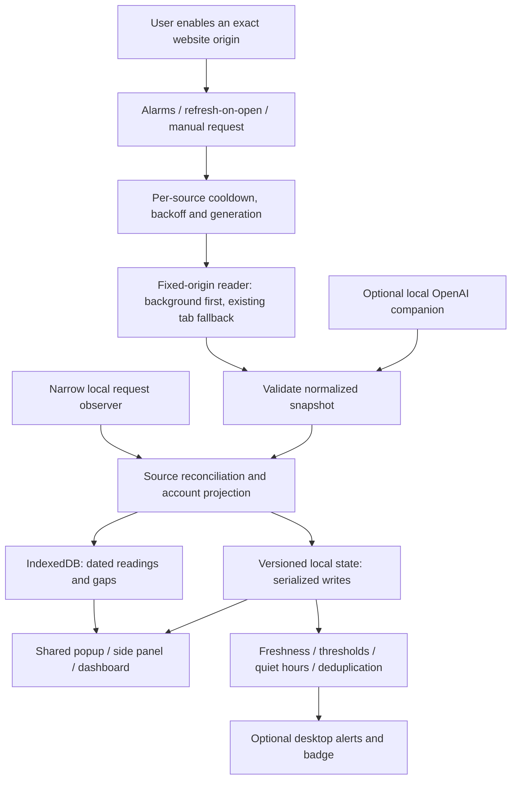

# Architecture — implemented Phase 1

MyLimits 2.0 is a local Manifest V3 extension. No backend or cloud authorization
is required. The [master plan](V2-IMPLEMENTATION-PLAN.md) defines later work;
[this handoff](PHASE-1-HANDOFF.md) records current evidence.

## Boundaries and authoritative data

- `src/core`: browser-independent contracts, source reconciliation, actions,
  migration, scheduling policy, freshness, alerts and export projection.
- `src/providers`: declared exact origins, injected reader transport, pure parsers
  and typed failures. Internal website interfaces remain live-unverified.
- `src/platform`: optional permissions, fixed network transport, controller,
  serialized repository, IndexedDB and validated runtime commands.
- `src/ui`: shared React views/selectors; sample preview is isolated in memory.
- `entrypoints`: background, narrow content observer, popup, dashboard, side panel.
- `companion`: optional independently authorized local Codex service/native host.

The writable aggregate is `Store.version = 2`. It contains accounts (identity
and preferences), workspaces, independently addressable connections, latest
source snapshots, settings and bounded deduplication ledgers. A snapshot preserves
observation time, ingestion time, scope, evidence, reset identity and connector
version. The reconciler owns freshness/source selection. Account meters/status
are a materialized read projection retained for common views and existing parser
consumers, not a second independently maintained quota database.

Public state and exports allowlist fields. Installation salt, raw workspace
routing IDs, internal generations and authentication are not public UI data.
Website/session bearer values exist only in the request path, never in snapshots.
The extension does not store passwords, copied cookies or refresh tokens.

## Account, workspace and source identity

Website identity is verified in memory then salted/hashed. Existing IDs are
preserved; legacy IDs may combine account and workspace. Explicit Claude workspace
selection uses validated membership choices, hashed public workspace IDs and a
private routing ID. An inaccessible selected workspace fails visibly rather than
silently moving readings to another workspace. A default choice can use the
first eligible membership when no workspace has been selected.

A website collector binds to one current login. Rebinding advances its generation,
remembers the previous account and keeps that account's nickname/history.
Independent companion sources are unaffected. Separate native profile IDs remain
opaque and never imply a verified website identity merge. No fuzzy account merge
or cross-workspace quota sum is performed.

Gemini/Grok/Perplexity observations are explicitly browser-scoped. They cannot
establish a remote account or infer an allowance from a message count.

## Collection, concurrency and failure recovery

Chrome alarms default to five minutes. Popup opening refreshes only as needed;
ordinary UI storage reads do not initiate collection. At most two website reads
run together. Same-source overlapping requests coalesce, queued work can abort,
and disabled/forgotten/rebound generations reject late results. State mutations
serialize through one repository queue.

Background fetch uses fixed origins and timeouts. An existing permitted page can
provide context when needed; no hidden tab or login window is created. Typed
errors distinguish sign-in, missing page, provider denial, offline, throttling
and unverifiable responses. The native bridge uses its existing coalesced
request/status path independently of website transport.

Next attempts and exponential failure backoff persist across worker restarts.
Provider retry instructions are capped at 24 hours; ordinary exponential backoff
caps at an hour. A 15-second click cooldown and persisted retry wait apply before
requests; explicit reconnect resets local scheduling. Authentication rejection
pauses scheduled/open retries until a manual/relevant website recovery event.
A failed request never changes the observation time of the previous reading.

Freshness uses each meter's observation time, active source status and reset
expiry. Expired windows await a new reading; a countdown reaching zero does not
refill a meter. Unknown is null/absent, reported zero is valid, and scopes are
never combined into an overall AI percentage.

## Alerts

Optional notification permission is requested by a user action. Per-account
thresholds, mute, snooze and local quiet hours are applied before delivery.
Overnight quiet hours are supported; equal start/end means no quiet interval.
Suppression does not consume a threshold. After resuming, at most the most severe
currently relevant new threshold is sent from fresh reported readings.

Ledger keys include account/workspace/scope/meter; window identities and sent
thresholds rearm deduplication. Legacy ledger entries prevent duplicate upgrade
warnings. Failed delivery restores its ledger entry. Reset confirmation requires
a fresh later window/reset and supporting non-increased usage after the previous
reset, not passage of time alone. The badge uses the most constrained applicable
fresh reported meter and follows the Used/Remaining setting.

## History and deletion

IndexedDB `mylimits-history`, version 2, preserves the `readings` store and original
`account`/`time` indexes, adding `snapshotKey` uniqueness and `account-time`
pagination. Legacy points retain their account/time/percentages and a legacy
source label; missing scope/evidence is not fabricated. New readings preserve
observation/receipt times, source, scope, evidence and reset/window metadata.

Writes deduplicate snapshots and prune older-than-30-day observations after a
successful new save. Reads use bounded stable timestamp/primary-key cursors.
Basic bars represent discrete observations and do not interpolate missing usage.
A history write error becomes a visible warning without discarding current data.
Safe JSON/CSV exports are versioned, allowlisted and bounded; CSV neutralizes
formula prefixes in names. There is no credential import/account merge path.

Disconnect pauses a website collector or requests native logout. It keeps dated
readings. Failed native logout retains the profile so the user can retry; it does
not assert remote revocation. Confirmed forgetting removes account preferences,
snapshots, matching history and recovery-copy entries, disables its current
collector and retains only opaque disabled source markers to reject late messages.
History saving shares the serialized state queue so a late save cannot recreate
a forgotten account. Clearing history alone leaves account preferences intact.

## V1 → V2 migration and recovery

Keys:

- `mylimits:state:v1`: original legacy record.
- `mylimits:backup:v1`: validated recovery copy.
- `mylimits:state:v2`: current writable aggregate.
- `mylimits:migration:v2`: resumable prepared/state-written/history-ready/completed journal.
- `mylimits:active-schema`: set to `2` only after V2 validation and history upgrade.

Migration preserves IDs, salt, aliases, preferences, native profile mappings,
notification deduplication and linked legacy history. Browser storage and IDB do
not share a transaction; journaled steps are idempotent and retryable. Fault
injection covers interruption after each write. A real Chromium profile restart
also verifies V1 storage and IDB upgrade. Malformed/future versions or storage
failure produce a recovery error, never an automatic empty-state reset.

For an interrupted migration, close MyLimits pages and reload the same extension
ID; it resumes from the journal. Preserve the browser profile before manual
recovery. If a parse/version error persists, inspect the keys in the extension
worker without publishing their contents; do not delete state to hide the error.

**Rollback is not downgrade compatibility.** A V1 build cannot read subsequent
V2-only preferences/history metadata. The preserved V1 state can recover the old
state in a separately backed-up profile, but does not include later V2 changes.
Keep a profile backup and export readings before intentionally downgrading.
Explicitly forgotten accounts are pruned from V1 recovery copies too. No automatic
rollback overwrites valid V2 writes.

## Observation/message boundary

The main-world hook allows only selected exact origins, paths and methods. It
observes successful request metadata without reading prompt/response bodies.
The isolated script and worker validate origin, provider, enabled status, sender,
event ID and command schema. Provider pages cannot issue dashboard commands or
select arbitrary fetch URLs. Connector code ships with extension releases.

## Phase 2 history evidence

History insights group by account, source, workspace, scope, meter, reset window
and currency. Missing collection periods (over 15 minutes or three refresh
intervals) and negative usage deltas split chart segments. A bounded query reads
up to 5,000 recent rows per selected account and displays at most 32 series;
min/max downsampling retains bursts without connecting across gaps.
Pacing needs an active reported source, a fresh last reading, a future reported
reset, four observations over 30 minutes and positive, reasonably consistent
rates. It uses pairwise rates from at most 48 samples, quartiles and 20% padding
to show a headroom range. This is an estimate at a similar pace, not a predicted
cutoff or messages-left count. Subscription fees and local token-cost estimates
are not inferred from provider-reported spend.

Local retention is selectable at 30/90 days and applies immediately when saved.
The optional server applies the synced retention preference during upload;
one last-known reading per source remains cached even if older, with its original
observation date. This cache exception keeps offline accounts visible and does
not turn an old reading into a fresh quota.
