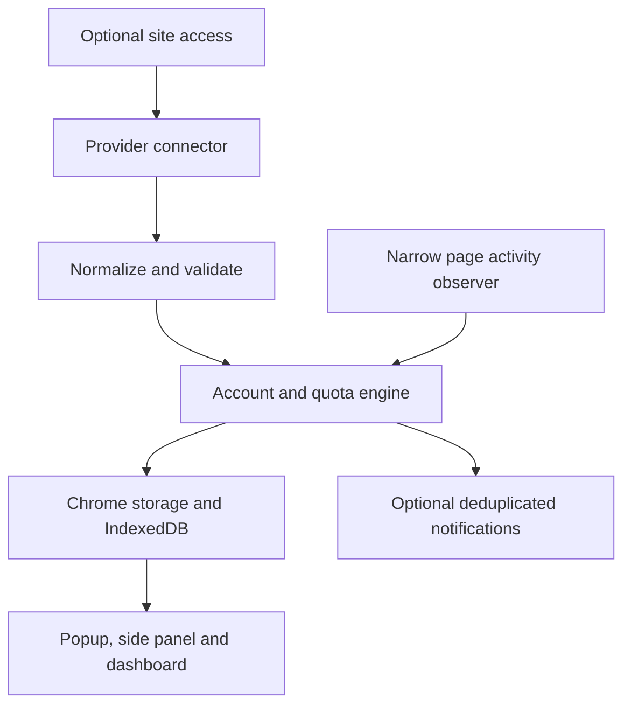

# Architecture

## Boundaries

- `src/core`: pure domain types, reset/freshness logic, identity hashing,
  account reconciliation, deduplication, and alert decisions. No browser APIs.
- `src/core/schema.ts`: runtime validation at storage and message boundaries.
- `src/providers`: fixed origins, isolated protocol readers, and pure parsers.
- `src/platform`: service-worker coordination, serialized writes, permission
  checks, local history, and typed messages.
- `src/ui`: extension-only React interface. Preview fixtures are opt-in and
  separate from persisted account data.
- `entrypoints`: WXT background, content script, popup, side panel, dashboard.

## Account lifecycle

A connector verifies a provider-specific identity in memory. The engine hashes
`installation salt + provider + account/workspace identity` and updates only
that account's record. A nickname, account alert preferences, and readings from
another login are not transferred to the new account. Earlier accounts from
that provider become inactive and keep their last known readings.

Workspaces and accounts are different concepts. The initial Claude reader
chooses the first eligible workspace; supporting explicit workspace selection
requires further observed protocol work. Separate Chrome profiles have
separate cookies, salts, records, and history.

Browser-only activity sources use an explicitly labelled browser-scoped record
and never pretend to know the signed-in account or its remaining subscription.

## Reading lifecycle

Provider percentages and reset timestamps become validated meters. Scope is
preserved: subscription, Work/Codex, chat, or local browser. Different scopes
are never summed into a universal AI percentage.

Missing data is null or absent, not zero. A reported zero is valid. A reading
becomes stale when its account is inactive, refresh fails, its freshness window
expires, or its reported reset time passes. The UI can show the dated previous
reading; badges and desktop alerts only use fresh data.

## Refresh and concurrency

Writes are serialized through one repository queue. Only one provider refresh
runs at a time per provider. Disabling a provider advances a generation marker;
an older in-flight result cannot reactivate it or overwrite new state.

Scheduled refreshes use Chrome alarms. Failures back off up to an hour. Manual
refresh has a short cooldown. Cookie-based requests try the background first;
if page context is necessary, they use an existing permitted tab. No background
tabs, login windows, copied cookie stores, or session tokens in storage.

## Alerts

Each account/meter/reset-window has a deduplication ledger. The most severe
newly crossed threshold generates one notification. A later critical crossing
can generate a second notification. New reset windows rearm the ledger.
When a reset timestamp is unknown, recovery by at least five percentage points
above a threshold rearms that threshold. Muted accounts, local counts, stale
readings, and unknown quotas cannot notify.

## Page observer boundary

The main-world hook allows only selected provider origins, paths, and methods.
It observes successful requests without reading bodies and posts a small event
to an isolated content script. The worker checks sender ID, exact URL/provider
match, enabled status, command schema, and event identity. Page-originated
data is never allowed to select arbitrary fetch URLs or issue dashboard commands.

## Expanding coverage

Add a catalog entry, fixed transport, pure parser, sanitized fixtures, and tests.
Verify actual identity and quota scope before enabling an account reader.
Prefer provider-reported usage, then narrowly targeted visible quota metadata.
If neither exists, expose an honest observed count with unknown remaining
quota. Ship connector fixes inside extension releases, not remote executable code.
