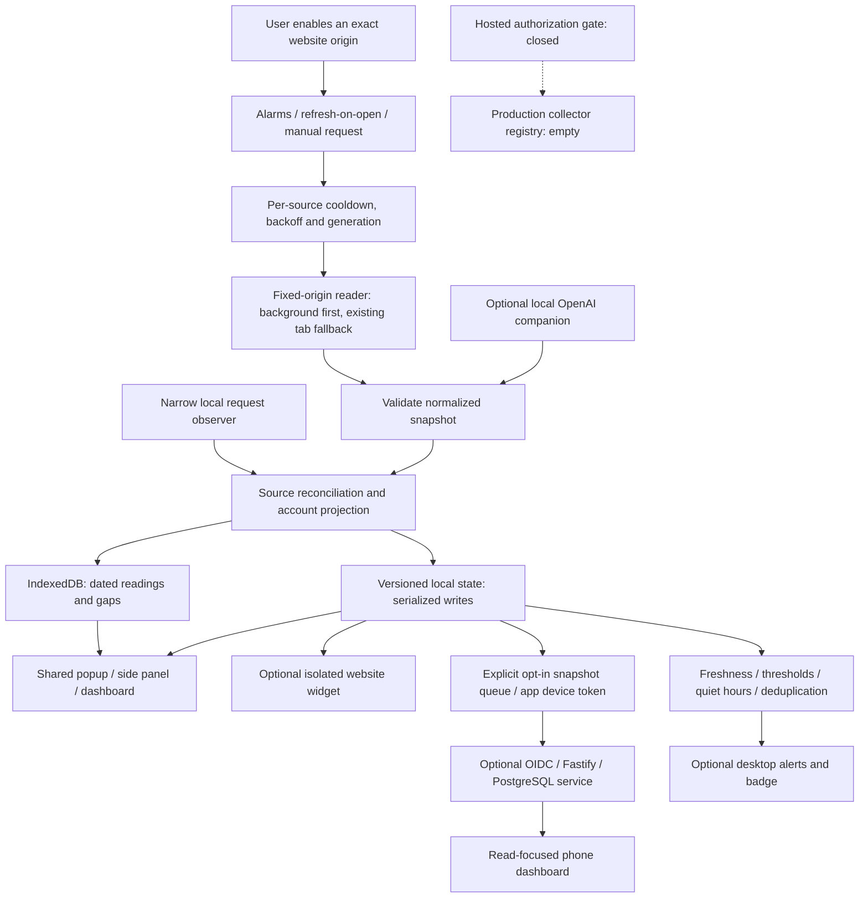

# Current Desktop accounts extension (3.4)

The + independent path now uses `OpenAICompanion` / `platform/companion.ts` and
the allowlisted Native Messaging host, not the empty hosted registry. The local
daemon manages per-connection official profiles, generation-bound confirmation,
bounded refresh and owned-process recovery. Official Codex App Server RPC owns
OpenAI authorization; unmodified Claude Code owns Claude authorization and /usage.
Separate external browser profiles handle sign-in without borrowing website cookies.
Pending confirmation survives restart. Readings retain their successful fetch time
through failures; provider observation time remains unknown unless supplied.

Windows setup downloads pinned official dependencies, registers discovered extension
origins, activates program directories with rollback and confirms local bridge health.
Provider credentials live outside runtime update directories. Detailed acceptance
and remaining gaps are in [the handoff](DESKTOP-ACCOUNTS-HANDOFF.md).

## Earlier hosted foundation (3.3, deferred)

Version3.3 adds `src/core/hosted-contracts.ts` (strict public metadata),
`src/core/hosted.ts` (additive local projection), `src/platform/hosted.ts`
(background-only API/auth-window routing), and capability-aware + UI.

`server/src/hosted.ts` owns durable owner-scoped attempts/identity/lifecycle;
`hosted-jobs.ts` owns bounded leases, cooldown/backoff and successful dated reads;
`transit-kms.ts` wraps envelope keys through configured Vault transit. Migrations
006–008 are additive. Official driver maps are empty: actual OpenAI/Claude
hosted integration is blocked. No generic credential-upload or callback proxy
exists. Test drivers are forbidden outside test environment.

MyLimits identity and optional device pairing reuse the existing OIDC/API boundary.
Hosted-only pairing does not consent to website snapshot upload. The compact view
uses prefixed remote IDs; it never merges remote identity into website/native
accounts by email or nickname. Existing local IDs/preferences/IndexedDB history
are preserved. History mirrors are bounded; immutable server/IndexedDB records
retain their original successful fetch/observation timestamps.

See [Desktop delivery and pending acceptance](DESKTOP-ACCOUNTS-HANDOFF.md),
[handoff](IMPLEMENTATION-HISTORY.md) and [operator setup](SERVER-SETUP.md).
The older architecture below records the earlier Phase2 baseline; Guide was
removed in3.0 and is not restored by this work.

---

# Architecture — implemented Phase 2

MyLimits 2.1 is a local Manifest V3 extension with an optional separate snapshot service. Local tracking requires no backend account. The [master plan](https://github.com/voiddev011/mylimits/blob/73799f592b43a8aeac89776700239a42a06056b8/docs/V2-IMPLEMENTATION-PLAN.md) defines contracts; [this handoff](https://github.com/voiddev011/mylimits/blob/73799f592b43a8aeac89776700239a42a06056b8/docs/PHASE-2-HANDOFF.md) records current evidence.



## Boundaries and authoritative data

- `src/core`: browser-independent contracts, source reconciliation, actions,
  migration, scheduling policy, freshness, alerts and export projection.
- `src/providers`: declared exact origins, injected reader transport, pure parsers
  and typed failures. Internal website interfaces remain live-unverified.
- `src/platform`: optional permissions, fixed network transport, controller,
  serialized repository, IndexedDB and validated runtime commands.
- `src/ui`: shared React views/selectors; sample preview is isolated in memory.
- `entrypoints`: background, narrow content observer, popup, dashboard, side panel.
- `companion`: optional independently authorized local Codex service/native host.
- `server`: separately installed OIDC snapshot API, PostgreSQL leases/credential interfaces and phone web view; production hosted collectors remain disabled.

The writable aggregate is `Store.version = 2`. It contains accounts (identity
and preferences), workspaces, independently addressable connections, latest
source snapshots, settings and bounded deduplication ledgers. A snapshot preserves
observation time, ingestion time, scope, evidence, reset identity and connector
version. The reconciler owns freshness/source selection. Account meters/status
are a materialized read projection retained for common views and existing parser
consumers, not a second independently maintained quota database.

Public state and exports allowlist fields. Installation salt, raw workspace
routing IDs, internal generations and authentication are not public UI data.
Website/session bearer values exist only in the request path, never in snapshots.
The extension does not store passwords, copied cookies or refresh tokens.

## Account, workspace and source identity

Website identity is verified in memory then salted/hashed. Existing IDs are
preserved; legacy IDs may combine account and workspace. Explicit Claude workspace
selection uses validated membership choices, hashed public workspace IDs and a
private routing ID. An inaccessible selected workspace fails visibly rather than
silently moving readings to another workspace. A default choice can use the
first eligible membership when no workspace has been selected.

A website collector binds to one current login. Rebinding advances its generation,
remembers the previous account and keeps that account's nickname/history.
Independent companion sources are unaffected. Separate native profile IDs remain
opaque and never imply a verified website identity merge. No fuzzy account merge
or cross-workspace quota sum is performed.

Gemini/Grok/Perplexity observations are explicitly browser-scoped. They cannot
establish a remote account or infer an allowance from a message count.

## Collection, concurrency and failure recovery

Chrome alarms default to five minutes. Popup opening refreshes only as needed;
ordinary UI storage reads do not initiate collection. At most two website reads
run together. Same-source overlapping requests coalesce, queued work can abort,
and disabled/forgotten/rebound generations reject late results. State mutations
serialize through one repository queue.

Background fetch uses fixed origins and timeouts. An existing permitted page can
provide context when needed; no hidden tab or login window is created. Typed
errors distinguish sign-in, missing page, provider denial, offline, throttling
and unverifiable responses. The native bridge uses its existing coalesced
request/status path independently of website transport.

Next attempts and exponential failure backoff persist across worker restarts.
Provider retry instructions are capped at 24 hours; ordinary exponential backoff
caps at an hour. A 15-second click cooldown and persisted retry wait apply before
requests; explicit reconnect resets local scheduling. Authentication rejection
pauses scheduled/open retries until a manual/relevant website recovery event.
A failed request never changes the observation time of the previous reading.

Freshness uses each meter's observation time, active source status and reset
expiry. Expired windows await a new reading; a countdown reaching zero does not
refill a meter. Unknown is null/absent, reported zero is valid, and scopes are
never combined into an overall AI percentage.

## Alerts

Optional notification permission is requested by a user action. Per-account
thresholds, mute, snooze and local quiet hours are applied before delivery.
Overnight quiet hours are supported; equal start/end means no quiet interval.
Suppression does not consume a threshold. After resuming, at most the most severe
currently relevant new threshold is sent from fresh reported readings.

Ledger keys include account/workspace/scope/meter; window identities and sent
thresholds rearm deduplication. Legacy ledger entries prevent duplicate upgrade
warnings. Failed delivery restores its ledger entry. Reset confirmation requires
a fresh later window/reset and supporting non-increased usage after the previous
reset, not passage of time alone. The badge uses the most constrained applicable
fresh reported meter and follows the Used/Remaining setting.

## History and deletion

IndexedDB `mylimits-history`, version 2, preserves the `readings` store and original
`account`/`time` indexes, adding `snapshotKey` uniqueness and `account-time`
pagination. Legacy points retain their account/time/percentages and a legacy
source label; missing scope/evidence is not fabricated. New readings preserve
observation/receipt times, source, scope, evidence and reset/window metadata.

Writes deduplicate snapshots and prune older-than-30-day observations after a
successful new save. Reads use bounded stable timestamp/primary-key cursors.
Basic bars represent discrete observations and do not interpolate missing usage.
A history write error becomes a visible warning without discarding current data.
Safe JSON/CSV exports are versioned, allowlisted and bounded; CSV neutralizes
formula prefixes in names. There is no credential import/account merge path.

Disconnect pauses a website collector or requests native logout. It keeps dated
readings. Failed native logout retains the profile so the user can retry; it does
not assert remote revocation. Confirmed forgetting removes account preferences,
snapshots, matching history and recovery-copy entries, disables its current
collector and retains only opaque disabled source markers to reject late messages.
History saving shares the serialized state queue so a late save cannot recreate
a forgotten account. Clearing history alone leaves account preferences intact.

## V1 → V2 migration and recovery

Keys:

- `mylimits:state:v1`: original legacy record.
- `mylimits:backup:v1`: validated recovery copy.
- `mylimits:state:v2`: current writable aggregate.
- `mylimits:migration:v2`: resumable prepared/state-written/history-ready/completed journal.
- `mylimits:active-schema`: set to `2` only after V2 validation and history upgrade.

Migration preserves IDs, salt, aliases, preferences, native profile mappings,
notification deduplication and linked legacy history. Browser storage and IDB do
not share a transaction; journaled steps are idempotent and retryable. Fault
injection covers interruption after each write. A real Chromium profile restart
also verifies V1 storage and IDB upgrade. Malformed/future versions or storage
failure produce a recovery error, never an automatic empty-state reset.

For an interrupted migration, close MyLimits pages and reload the same extension
ID; it resumes from the journal. Preserve the browser profile before manual
recovery. If a parse/version error persists, inspect the keys in the extension
worker without publishing their contents; do not delete state to hide the error.

**Rollback is not downgrade compatibility.** A V1 build cannot read subsequent
V2-only preferences/history metadata. The preserved V1 state can recover the old
state in a separately backed-up profile, but does not include later V2 changes.
Keep a profile backup and export readings before intentionally downgrading.
Explicitly forgotten accounts are pruned from V1 recovery copies too. No automatic
rollback overwrites valid V2 writes.

## Observation/message boundary

The main-world hook allows only selected exact origins, paths and methods. It
observes successful request metadata without reading prompt/response bodies.
The isolated script and worker validate origin, provider, enabled status, sender,
event ID and command schema. Provider pages cannot issue dashboard commands or
select arbitrary fetch URLs. Connector code ships with extension releases.

## Phase 2 history evidence

History insights group by account, source, workspace, scope, meter, reset window
and currency. Missing collection periods (over 15 minutes or three refresh
intervals) and negative usage deltas split chart segments. A bounded query reads
up to 5,000 recent rows per selected account and displays at most 32 series;
min/max downsampling retains bursts without connecting across gaps.
Pacing needs an active reported source, a fresh last reading, a future reported
reset, four observations over 30 minutes and positive, reasonably consistent
rates. It uses pairwise rates from at most 48 samples, quartiles and 20% padding
to show a headroom range. This is an estimate at a similar pace, not a predicted
cutoff or messages-left count. Subscription fees and local token-cost estimates
are not inferred from provider-reported spend.

Local retention is selectable at 30/90 days and applies immediately when saved.
The optional server applies the synced retention preference during upload;
one last-known reading per source remains cached even if older, with its original
observation date. This cache exception keeps offline accounts visible and does
not turn an old reading into a fresh quota.

## Local Guide

The dashboard-only Guide uses dated product-scope metadata plus original rules,
not model benchmarks. Work/Codex and Cursor pools are coding-only; Perplexity
Pro/research counts are research-only. Fresh applicable readings are required;
unknown, stale, exhausted, spend-only and user-excluded options get explicit
reasons. Broad mode suggestions do not assert model access on a user's plan.
Accounts remain independent options, without ranking unrelated percentages.
Optional local pacing context must match the source, meter and reset window.

The prompt reviewer counts words/characters, not fabricated tokens or savings.
Text and handoff fields live only in component memory. They are absent from
storage, export and sync. Editing a handoff invalidates its preview; copy/download
is offered only after an explicit preview. Nothing is scraped, summarized by an
AI or sent to another provider. Product/source links reviewed 16 October 2026 are
included in the Guide itself; consult the provider for currently available modes.

## Optional website widget

`widget.content.ts` registers at runtime only for selected exact provider hosts.
It uses Shadow DOM, safe fixed corners, bounded dimensions and textContent.
A singleton and a document-root child observer recover its own removed anchor
without examining conversations or replacing page input. One local state query
per minute updates age, with debounced background refresh notifications after
saved readings change. These queries do not call providers or trigger refreshes.

Content-origin messages are restricted to a tiny public projection and widget
collapse/position/hide/open-dashboard actions. Provider URL, extension sender ID,
main frame, enabled tracking/widget and current host grant are checked. The page
gets no postMessage bridge; content controls ignore synthetic events. Dashboard
URLs are fixed by the extension. General UI/state/sync messages still require an
extension-page sender. Removing a grant unregisters scripts and removes visible
widgets across tabs. Widget settings are separate local storage, not synced.

## Retained V2 implementation contracts


These historical contracts remain relevant to the stable code on this branch.


These are proposed contracts. Finalize them in P1-02 against the existing code,
record any justified adjustment, and keep the same semantics throughout both
phases. Avoid implementing a second competing model in UI or server code.

### Identity and connections

- Preserve existing account IDs and installation salt through migration; old IDs
  may already combine account and workspace. Preserve that mapping until verified
  evidence supports a more granular mapping. Do not reverse hashes or guess raw IDs.
- A user-facing account can have several sources, but browser sessions, native
  profiles and cloud grants remain independently addressable connections.
- A workspace is explicit when verified. `null` means no known workspace, not
  permission to combine workspaces.
- Suggested connection kinds: `website`, `companion`, `independent-local`,
  `cloud`, `snapshot-import`. Only implement usable kinds in each phase; listing
  a kind in a type does not enable that connection method.
- Suggested lifecycle: `disabled`, `checking`, `active`, `needs-auth`,
  `needs-tab`, `unavailable`, `offline`, `error`. Derive the display-only
  “remembered” account label from its connections and dated readings.
- One website-session connection may change the detected current account when
  the user signs into another login. Detach its live mapping from the previous
  account while retaining that account's nickname and snapshot. Native/cloud
  connections for other accounts must remain active.
- Increment a connection generation on disable, disconnect, account rebinding
  or credential replacement. A response from an older generation cannot mutate
  current state. Account deletion additionally removes history and preferences.

### Snapshot contract

Use runtime-validated data with the following fields or their documented equivalent:

```ts
type Evidence = 'reported' | 'observed' | 'estimated';
interface UsageSnapshot {
  schemaVersion: 2;
  snapshotId: string;
  providerId: string;
  accountId: string;
  connectionId: string;
  workspaceId: string | null;
  observedAt: number; // milliseconds UTC; age of the actual reading
  receivedAt: number; // milliseconds UTC; local ingestion time
  connectorVersion: string;
  meters: UsageMeter[];
}
interface UsageMeter {
  id: string;
  label: string;
  scope: 'subscription' | 'work-codex' | 'chat' | 'api' | 'local';
  evidence: Evidence;
  unit: 'percent' | 'messages' | 'requests' | 'searches' | 'credits' | 'currency';
  used: number | null;
  total: number | null;
  usedPercent: number | null;
  currency: string | null;
  resetsAt: number | null;
  windowId: string | null;
  sourceLabel: string;
}
```

Reject non-finite values, negative counters and malformed timestamps. Percentage
clamping for visual display must not hide malformed input. A positive total is
needed for division; reported zero is valid and unknown is `null`. Monetary
values require a currency and cannot silently mix currencies. Retain separate
windows even if their reset times coincide. Validate clock skew/old arrivals
before selecting the current snapshot; a newer arrival can contain older data.

Transport-level transient identity/authentication is not part of the public
snapshot. Account verification happens before publishing the normalized record.
The UI never receives raw responses, salts, cookie values, access/refresh tokens
or native bridge secrets.

### Adapter and capability contract

An adapter takes a permitted connection context and abort signal, returns a
normalized validated snapshot or typed error, and declares fixed provider
origins. Inject transport and clocks for tests. Errors distinguish authentication,
missing page context, permission denial, network/offline, throttling with retry
time, unsupported quota scope and unexpected response shape.

Capabilities record tab-independent access, account-wide scope, supported meters,
multi-account behavior, independent authorization, renewal and hosted deployment.
Each includes `supported`, `unsupported` or `unverified`, its evidence level
(`documentation`, `fixture`, `live`), last check date and connection type.
Do not promote documentation/fixture evidence into live support automatically.

### Storage and messages

- Existing state key: `mylimits:state:v1`. Introduce an explicitly versioned V2
  key only after schema validation and backup; preserve V1 for recovery. A pointer
  to the active schema is written only after the V2 state is durable and validated.
- Existing IndexedDB: `mylimits-history`, version 1, store `readings`, indexes
  `account` and `time`. Browser storage and IndexedDB do not share an atomic
  transaction: use a resumable migration journal and make retries idempotent.
- Default history retention remains 30 days until Phase 2 changes it explicitly.
  Keep legacy history usable with a documented legacy-source mapping.
- Serialize writes; reject unrecognized versions without resetting data. Never
  “fix” parse failure by silently creating an empty store over the saved record.
- Extend validated messages for connect/enable, account preferences, workspace
  selection, refresh by connection, disconnect, forget and paginated history.
  Public state uses purpose-built public types; private fields are not excluded
  merely by relying on callers to ignore them.
- Keep the current observation sender/origin/path checks. Page messages cannot
  choose arbitrary fetch origins, invoke cloud actions or issue UI commands.

### Alert and timing contract

Use one unit throughout storage and messages: epoch milliseconds. Convert source
seconds/durations in parsers only. Clock injection makes reset/freshness tests
deterministic. Schedule collection with browser alarms, not a permanent worker
loop. Refresh-on-open reuses an already fresh/in-flight read rather than causing
a network storm. The quiet-hours policy uses local time with a defined overnight
range; it suppresses delivery, not quota collection.

Alert identities include account, workspace/scope, meter and reset window.
Do not collapse different quota windows into one ledger entry. Snooze/quiet
hours must not falsely mark an undelivered alert as delivered. When notifications
resume, alert once only if a fresh currently low reading still warrants it.

## Persistent-accounts C1: request diagnostics

The current experimental branch adds a browser-injected, bounded session buffer
(src/platform/diagnostics.ts). Controller supplies it and the connection's last
successful fetch time to readProvider; adapters observe background and page
responses without changing authentication or quota parsing rules. Strict
metadata reconstruction happens before storage and again on read. A dashboard-only
request-diagnostics message feeds the existing safe-diagnostics copy action.
Storage failures degrade to memory and do not fail quota collection. No new
permissions, session capture or independent browser credentials are enabled.
