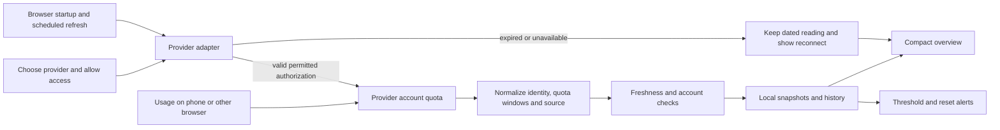

# MyLimits: competitor research and product direction

Research date: **15 October 2026**. Scope: **24 comparable products/projects**, covering browser extensions, desktop applications and prototypes, plus adjacent reporting tools. Prepared for a nontechnical user on **Windows with Chrome or Brave**.

## Recommendation

**Make the normal MyLimits experience extension-only:** install, choose a website, approve its site access, and reuse its existing login. Background polling should work without keeping the provider tab open wherever that provider permits it. The companion should remain an optional advanced connection.

The strongest references are **MyQuota** for onboarding, **AI Quota Monitor** for a compact overview, **TokenYou** for a small background-fetch architecture, **AI Limits** for provider-specific refresh rules, and **OpenQuota/SessionWatcher** for multiple-account presentation. **Tally** offers useful ideas for the later guidance features.

**No examined product established a verified, extension-only solution that keeps every provider updating after website logout with a permanent one-time login.** Some save additional credentials; desktop products can use separately authorized sessions. Those approaches have different setup, renewal and revocation behavior. They do not establish a universal guarantee.

## What was assessed

The requested features are: easy connection; periodic updates while the browser runs; account-wide usage including other devices; updates after website logout; multiple accounts with nicknames; a compact limits overview; low-balance alerts; and later efficiency/model/prompt guidance. Running while the browser is closed is **not required**.

This is a **source-based usability assessment**, not a hands-on benchmark. First-party websites, store descriptions, documentation and selected source files were examined. Competitors were not installed or connected to real accounts. Privacy, accuracy, latency and logout behavior were not independently certified.

Ranking priorities, in order:

1. Installation and connection effort for an ordinary Windows browser user.
2. How quickly the everyday view answers “what is left, and when does it reset?”
3. Relevant subscription-quota coverage, with accurate source labels.
4. Clear errors, stale readings and reconnection behavior.
5. Multiple-account support and room for the requested guidance features.

Ranks are editorial judgments from the documented flows, not measured scores. Open source helps inspectability; it does not automatically make a product easier to use. Desktop apps and single-provider tools are ranked separately because their prerequisites differ.

“Public MIT” below means the project declares an MIT license. “Non-public source” means no public application repository/license was verified in this research; it is not proof that source can never be obtained. Proprietary product terms do not authorize copying implementation code.

## 1. Multi-provider browser extensions: usability ranking

These are the closest comparisons to the intended MyLimits product. Provider counts are publisher claims and can mix consumer websites, coding subscriptions, API billing and custom instances.

| Rank | Product and source status | Connection and everyday experience | Main qualification |
| --- | --- | --- | --- |
| **1** | [MyQuota](https://myquota.ai/) · non-public source · free | Store installation, provider switches, existing login; popup, side panel and small page widget. Current site lists 10+ providers. | Requires the intended website login in the same profile. Some refreshes use a temporary background tab. Chrome sync carries saved readings, not independent authorization. |
| **2** | [AI Quota Monitor](https://aiquotamonitor.com/) · proprietary/non-public source · free listing | Store installation; one/two-column tiles, expandable limits, reset timers and a worst-window badge. | Optional credential handling is more involved than the headline suggests. Its privacy policy describes retained session material and provider-specific renewal. |
| **3** | [AI Limits — TiantianFlow](https://github.com/TiantianFlow/ai-limits) · public MIT | Store distribution; side panel, Used/Left views, pacing and local history. Documents 20 provider integrations. | Coverage mixes website sessions, API keys and relay instances. Certain providers need a page context; automatic refresh cannot always do what a manual refresh does. |
| **4** | [AI Usage Tracker — cupcakedev](https://github.com/cupcakedev/ai-usage-extension) · public MIT | Store distribution; popup, badge and compact page overlay; adjustable polling. | Current repository lists more coding-plan integrations than older store copy. Verify support against the installed version. Some connections need extra credentials. |
| **5** | [TokenYou](https://github.com/diegoparras/tokenyou) · public MIT · free | Existing login, per-provider access, five-minute refresh, popup and configurable meters. Plain extension with no build step for manual loading. | [Website](https://getescriba.com/tokenyou/en/) still describes Web Store publication as forthcoming. Manual developer-mode installation lowers consumer usability. |
| **6** | [Tokenwatch — browser extension](https://chromewebstore.google.com/detail/tokenwatch/deckpeoackfcjdkjghajbcmbgbadmdho) · non-public source | Simple quota/reset view using existing browser logins; Claude, ChatGPT, Gemini and Antigravity advertised. | Antigravity has a separate optional macOS companion. Ordinary browser connections still depend on their authentication. Distinct from other products named TokenWatch. |
| **7** | [QuotaMeter](https://www.quotameter.app/) · commercial/non-public source | Chrome extension with a unified dashboard, badge and configurable alerts. Website and API connections are separate. | Paid activation; current price did not render in the inspected page. macOS/editor editions are marked forthcoming despite cross-platform-sync marketing. |
| **8** | [AI Usage Limit Alerts](https://chromewebstore.google.com/detail/ai-usage-limit-alerts/nfnpdgcjkggjhkhedkkfhppeeaeopdbo) · non-public source | Store installation; four advertised services, popup/page indicators and low/reset alerts. | Website-session dependence remains; less public technical evidence for independent accounts and durable renewal. |
| **9** | [Brim — Antimony Studio](https://chromewebstore.google.com/detail/brim-%E2%80%94-ai-%EC%82%AC%EC%9A%A9%EB%9F%89-%EC%B6%94%EC%A0%81/fojanmohhailbgifhkokjifbkdnehlhf?hl=en) · non-public source | Claude/Gemini multi-account dashboard and “use this now” suggestion; saved results can be viewed on the web. | Adds its own Google login/cloud storage. Listing explicitly says desktop Chrome collects the data and mobile views saved results. Narrower fit for a local, broadly supported extension. |

**Interpretation:** MyQuota and AI Quota Monitor are the closest documented consumer experiences. TokenYou is the strongest small architectural reference, even though its installation is less polished. AI Limits is particularly useful for understanding why one refresh strategy cannot cover every website.

### Important findings behind the ranking

**MyQuota:** the onboarding guide explicitly requires staying signed in. It distinguishes a stale last reading from a fresh one. Its FAQ acknowledges background tabs and multiple-Google-account targeting problems. The desktop notification feature described there concerns projected spend and is off by default; visual quota warnings should not be confused with enabled desktop quota alerts. [Publisher guide/FAQ](https://myquota.ai/)

**AI Quota Monitor:** the policy says it can store provider session material, read Kimi access/refresh tokens and renew that session. Manual keys/tokens are also optional. Therefore “no separate account” does not mean “no additional credential management.” Whether saved authorization survives logout depends on that provider; no live logout test was performed. [Policy section](https://aiquotamonitor.com/#privacy)

**AI Limits:** scheduled refresh avoids opening tabs. Some manual refreshes can recover a session with an inactive tab; Grok can require an existing page during automatic collection. Its FAQ makes these differences unusually explicit. Multiple relay instances are supported, but that alone does not establish simultaneous independent Claude or ChatGPT website accounts. [FAQ](https://github.com/TiantianFlow/ai-limits/blob/main/FAQ.md)

**TokenYou:** the examined ChatGPT adapter obtains an access token from the current website session and then requests usage. A missing session is an authentication failure. Its shared HTTP layer includes website credentials. This supports tab-independent polling while the session remains valid, not a promise to continue after logout. [ChatGPT adapter](https://github.com/diegoparras/tokenyou/blob/main/src/adapters/chatgpt.js), [HTTP layer](https://github.com/diegoparras/tokenyou/blob/main/src/lib/http.js)

## 2. Single-provider browser tools

For someone using only Claude, a specialist can be easier than any multi-provider dashboard. These ranks favor the requested monitoring core; guidance features are discussed separately.

| Rank | Tool | Usability and inspiration | Limitation |
| --- | --- | --- | --- |
| **1** | [Claude Monitor](https://github.com/claude-monitor/claude-monitor-browser-extension) · public MIT | Store distribution, optional small composer bar, thresholds, reset timers, pace/history and stale-state handling. [Publisher](https://claude-monitor.com/) | Claude only. Expired login preserves a dated reading; it does not demonstrate independent authorization. |
| **2** | [Tally — divykairoth](https://chromewebstore.google.com/detail/tally-%E2%80%94-claude-token-coun/baicaaiepddopbodaccgfffdimceidbp?hl=en-US) · commercial/non-public source | Small usage strip, estimated messages left, model-aware guidance and deliberate conversation handoff. Free monitoring; paid advanced actions. | Remaining-message predictions are estimates. Handoff/fork/export features access conversation content. Uses the current Claude session. |
| **3** | [Arken Limit Monitor](https://www.arkenapps.com/arken-limit-monitor.html) · public MIT projects | Collapsible meter/pill, alerts and clear access explanations; plain JavaScript distribution. | Separate Claude and ChatGPT extensions. Claude has Store installation; ChatGPT is documented as a GitHub/developer-mode install. ChatGPT figures concern Work/Codex. |
| **4** | [Clauge](https://chromewebstore.google.com/detail/clauge-%E2%80%94-your-claude-usag/cfikllgngkblaoelhoblkkkjlaagmooi) · non-public source | Usage/reset view, estimated messages, concise-output assistance and cross-service conversation transfer. | More relevant to later coaching than broad quota collection. Estimates and conversation-processing features need separate explanation. |
| **5** | [cfranci/claude-usage-extension](https://github.com/cfranci/claude-usage-extension) · public code; license grant not independently verified | Demonstrates direct usage requests with a separately supplied access token. | Manual developer-mode installation and token entry/expiry handling are unsuitable as the default consumer setup. Public code alone is not sufficient reuse permission. |

Tally’s useful product idea is translating an abstract balance into an understandable decision. MyLimits can offer “try a smaller model for this task” or a clearly labeled range for remaining work. Fixed model-consumption ratios should not be treated as provider guarantees. Token cost, context length, caching and subscription allocation can differ.

## 3. Desktop tools: Windows usability ranking

These are alternatives and design references, **not extension-only solutions**. A download can be easier than our current companion commands, but remains an additional installation. Rankings assume any required AI-tool login already exists; otherwise setup is longer.

| Rank | Tool | What is useful | Setup/coverage tradeoff |
| --- | --- | --- | --- |
| **1** | [SessionWatcher](https://sessionwatcher.com/facts) · commercial/proprietary | Packaged Windows/Mac app, existing-tool credentials, compact taskbar view, alerts, pace and multiple Claude/Codex accounts on Pro. | Some providers need an in-app login or key. Pro currently costs $24/year or $59 lifetime; [pricing](https://sessionwatcher.com/pricing) states lifetime increases on 1 November. Windows installer is described as unsigned. |
| **2** | [OpenQuota](https://github.com/deviffyy/OpenQuota) · public MIT | Windows/Mac/Linux installers; compact floating/tray panel, reordered/pinned meters, Used/Left and pacing. | Mostly coding-tool credentials rather than browser-only consumers; some API keys. Repository states native package signing is not enabled by default. |
| **3** | [Win-CodexBar](https://github.com/nesszer/Win-CodexBar) · public MIT | Windows installer/portable app; provider grid, source selection, optional cookie import and protected app-managed credentials. | Broad configuration surface. “100+ providers” includes billing/credit services. Its own README contains differing release references, so installed-release verification matters. |
| **4** | [UsagePeek AI](https://usagepeek.com/) · commercial/non-public source | Microsoft Store Windows app; integrated Claude sign-in, tray ring and small widget with a selectable primary meter. | Claude only. Its own session is a plausible route to independence from Chrome login, but that logout behavior was not tested or guaranteed by this review. Store determines pricing. |
| **5** | [CodeZeno Claude Code Usage Monitor](https://github.com/CodeZeno/Claude-Code-Usage-Monitor) · public MIT | Downloadable Windows executable, taskbar widget, multiple Claude/Codex accounts and distinct connection-error states. | Assumes supported local tools are installed/signed in. Some providers have manual credential setup. Excellent coding-user fit, less suitable for website-only users. |

**Best exact reference for account nicknames:** OpenQuota documents separate Claude profiles with independent quota cards, rename controls and preserved customization when a login disappears. It also documents expired-token reconnection. Nicknames and durable authorization are separate problems. [Claude account documentation](https://github.com/deviffyy/OpenQuota/blob/main/docs/providers/claude.md)

### Other valuable desktop references

| Product | Source/platform | Why inspect it |
| --- | --- | --- |
| [CodexBar](https://github.com/steipete/CodexBar) | Public MIT; principally macOS GUI, with Linux support | Rich provider/source architecture, compact meters, stale signals and pacing. Uses several auth sources; not a universal no-login connector. [Provider documentation](https://github.com/steipete/CodexBar/blob/main/docs/providers.md) |
| [OpenUsage — robinebers](https://github.com/robinebers/openusage) | Public MIT; macOS 15+ | Pinned metrics, always-visible/on-demand rows, cached-first rendering and normalized provider snapshots. Current native Swift product; distinguish similarly named terminal/self-hosted projects. |
| [AIUsageBar](https://www.aiusagebar.com/) | Commercial/non-public source; macOS | Simple headroom-focused menu, warning thresholds and a free Claude tier. Publisher advertises Pro at $9.99 once and 47+ integrations; that is not verified coverage of 47 consumer subscription quotas. |
| [UsageBar — vineellabs](https://github.com/vineellabs/usagebar) | Public code; no repository license detected in metadata; macOS | Saved Claude profiles, renaming and independent config directories. Developer-oriented build/CLI prerequisites. Its documentation notes credential-rotation complications; avoid its optional usage-starting “ping” as a tracking mechanism. |

## 4. Additional prototype and adjacent tools

[MuneebQureshi-9/ai-usage-tracker](https://github.com/MuneebQureshi-9/ai-usage-tracker) is another public-code extension prototype. Its documentation distinguishes implemented readings from partial/estimated provider coverage. It is a useful reminder to label evidence honestly, but was not ranked as a ready consumer product. A reusable license was not verified.

[ccusage](https://github.com/ryoppippi/ccusage) is relevant to local token/cost reporting, not evidence of remote consumer subscription headroom after logout. SDK observability products similarly need instrumented requests: routing future requests through a proxy does not reveal past usage made directly in ChatGPT, Claude or their mobile apps. These are adjacent categories rather than interchangeable quota connectors.

## 5. What actually enables updates?

| Situation | What must be available | Implication for MyLimits |
| --- | --- | --- |
| AI tab closed, browser running | Valid session and a usage endpoint callable without that page | Background extension polling can work. Some provider adapters still need page context. |
| Usage happens on another device | Endpoint reports the shared account/workspace quota | Next successful poll can see that server-side change. Local browser counters cannot. |
| User logs out of the provider website | Separately valid authorization, or retained credentials still accepted by the provider | Ordinary website-session polling can stop. Retained credentials may also expire or be revoked. |
| User opens Chrome again without opening the AI site | Extension starts, authentication is still valid, and adapter supports background fetch | Refresh can occur on startup; immediate UI should show the dated cache until success. |
| Browser fully closed or computer asleep | An independent collector would be needed | Outside the current requirement. Resume and refresh later. |
| Phone opens a synced dashboard | Another client collected and uploaded a reading | Seeing a saved snapshot is not independent live collection. |

### Four patterns found in the research

1. **Website-session polling.** Low setup effort. Reuses cookies or an access token obtained from a valid website session. Strong default for MyLimits; cannot promise survival of website logout. TokenYou and AI Limits demonstrate this for ChatGPT. [AI Limits adapter](https://github.com/TiantianFlow/ai-limits/blob/main/providers/chatgpt/adapter.ts)
2. **Retained provider credentials.** Some extensions store tokens and renew selected provider sessions. This can reduce repeated connection effort, but needs secure handling, provider-specific permission/renewal review and honest revocation behavior. The AI Quota Monitor policy documents this approach; it is not a universal logout guarantee.
3. **Independent native authorization.** Desktop tools reuse CLI logins or own separately authorized profiles. They can avoid dependence on one browser cookie jar, but need installed software and valid credentials. OpenQuota explicitly distinguishes Codex ChatGPT authorization from an API-key-only session. [Codex documentation](https://github.com/deviffyy/OpenQuota/blob/main/docs/providers/codex.md)
4. **Snapshot synchronization.** MyQuota uses Chrome sync; Brim uses a cloud dashboard. This distributes readings, not the right to fetch future readings after authentication stops. Chrome-to-Brave sharing and mobile collection must not be inferred from Chrome sync support.

For OpenAI, the official Codex App Server exposes `account/rateLimits/read` and update notifications. The documented example identifies a Codex bucket. This supports the optional independent Codex connection we built; it does not establish that all ordinary ChatGPT chat/model limits are available to every third-party extension. [Official App Server documentation](https://developers.openai.com/codex/app-server/)

Chrome can automatically **launch an already installed and registered** native host through native messaging. The host registration and executable still need installation. That is why “automatically run the companion command” cannot remove the initial installation requirement by itself. [Chrome native messaging documentation](https://developer.chrome.com/docs/extensions/develop/concepts/native-messaging)

## 6. MyLimits today compared with the references

Baseline: repository implementation at commit `9d9ad16f637c58dfc38656d9dc2f469fd8a05de0`, before this research document. [README](README.md), [adapters](../src/providers/adapters.ts), [controller](../src/platform/controller.ts), [companion guide](INSTALL.md).

| Requirement | Current MyLimits | Useful next step |
| --- | --- | --- |
| Easy website connection | Optional site access and existing sessions are already supported; companion setup is prominent | Make website tracking the first/default path. Move advanced independent connections behind an optional section. |
| Compact all-account view | Compact rows, search/filter/sort and expandable details exist | Make pinned session/weekly values visible together; hide setup text from the everyday overview. |
| Account nicknames | Saved accounts can be renamed; inactive website accounts retain dated readings | Add source-aware account status and workspace selection. Preserve names when credentials change. |
| Multiple live accounts | One current website login per provider/profile; optional isolated OpenAI companion profiles | Distinguish remembered accounts from independently refreshable ones. Validate each provider's multi-account auth before advertising it. |
| Low-limit alerts | Thresholds, per-account mute and reset-window deduplication already exist | Add optional reset alerts and explain which specific window constrains the account. |
| Exact provider quotas | Claude and Work/Codex adapters are prototypes awaiting real-account validation | Validate these first; add actual quota adapters for other providers individually. |
| Gemini/Grok/Perplexity | Currently local browser observations, not remaining account quotas | Replace or supplement counts only after a verified server-reported source exists. |
| Updates after logout | Optional separate OpenAI companion authorization; live logout/renewal validation pending | Publish capability per provider and connection type. Do not claim general support. |
| Guidance | Roadmap only | Add task/mode guidance after reliable tracking; make conversation inspection an explicit optional feature. |

MyLimits already contains several useful behaviors competitors advertise. The biggest gaps are **reliable provider validation, installation/distribution, connection clarity and independently refreshable multi-account support**. Adding more interface features alone will not fix those gaps.

## 7. Proposed system design, using our own implementation



Independent authorization, where supported, is another adapter connection type. It does not need to be imposed on every website connection. No server is required for the basic design.

### Provider coverage strategy

| Provider/category | Research lead | Release condition |
| --- | --- | --- |
| Claude | Website organization usage; specialist extensions handle multiple reported windows | Verify account/workspace identity, actual plan response and expired-session behavior. |
| ChatGPT/Codex | Existing website adapter and optional official App Server connection | Label returned buckets correctly; test shared-account updates and separate-session revocation. |
| Grok | TokenYou documents a rate-limit adapter | Confirm the applicable product/plan, allowed request context and whether a tab is necessary. |
| Perplexity | TokenYou documents a rate-limit adapter | Verify Pro/Research counters and reset meanings against the real account. |
| Gemini | TokenYou contains an internal quota-RPC adapter | Validate account selection, returned quota meaning and maintenance reliability; do not present local counts as account headroom. |
| Cursor/Copilot/coding plans | Browser and native projects document different quota/billing sources | Keep subscription limits, premium requests, credits and API spend as distinct meter types. |
| API providers/custom services | Some products use API/admin keys | Optional separate connection with the actual key scope explained; not a replacement for consumer subscription authorization. |

The inspected [TokenYou adapters](https://github.com/diegoparras/tokenyou/tree/main/src/adapters) offer research leads, not stable public API contracts. Internal routes, bootstrap tokens and response formats can change. Implement each connector independently with sanitized fixtures and a provider-specific support declaration.

### Original MyLimits logic to build on

- **Connection capabilities:** record whether a source requires a tab, survives tab closure, has independent authorization, supports renewal, can read multiple accounts, and reports account-wide usage. Use `unknown` until validated.
- **Account identity:** key readings by verified provider account/workspace and connection identity. Keep the nickname separate. Do not merge two accounts because their display names or balances match.
- **Freshness:** retain `observedAt`, `lastAttemptAt`, source, error and next permitted retry. Show “updated 3 min ago,” “needs sign-in,” or “local count” explicitly. Never repaint a failed request as a fresh reading.
- **Refresh scheduling:** refresh on startup, on user request and on provider-appropriate alarms; coalesce duplicate requests, honor backoff and avoid opening login windows automatically. A target interval is not a real-time guarantee.
- **Quota semantics:** preserve session/weekly/model/workspace buckets. A restrictive applicable bucket determines headroom; do not average percentages across providers or accounts into a fictional universal balance.
- **Alert engine:** warn on fresh threshold crossings, deduplicate by account/window/reset, and handle changed/reset windows without repeated notifications. Cached predictions alone should not trigger a factual “quota reset” alert.
- **Guidance engine:** start with explicit user task selection and transparent rules. Later use opt-in prompt analysis. Treat remaining-message counts as estimates with uncertainty and avoid claiming a fixed percentage saving.

### Compact overview sketch

Fictional example; balances are amounts left, and each reset belongs to its displayed window:

```text
MyLimits                    Updated 1m ago  ↻
Account          Session / reset     Week / reset
Claude Work         35% / 2h           62% / 3d
Claude Personal     80% / 4h           25% / 1d
Codex Main          55% / 1h           41% / 4d
GPT Other           — needs sign-in; last read 2h ago
Gemini              local count only; quota unknown

Select a row for details · Add website · Settings
```

An overview should fit the common 3–6-account case. Arbitrarily many accounts and quota windows cannot all fit without scrolling; pin key meters, collapse details and provide a full dashboard. “All limits first” should mean the important limits are immediately visible, not a promise of infinite rows in a popup.

## 8. Implementation priorities suggested by the research

1. **Simplify the default connection flow.** Website tracking first; companion optional. Explain the supported refresh behavior in one sentence per provider. Ship an installable release/store build so users do not need Node or build commands.
2. **Validate the first two providers end to end.** Claude and Codex: compare provider usage page, account/workspace, tab closure, browser restart, usage on another device, website logout and credential expiry. Record which cases pass for each auth source.
3. **Add more real quota sources.** Grok/Perplexity/Gemini are candidates, not promised support. Prefer reliable provider-reported data over inflated coverage counts.
4. **Finish account management.** Nicknames, clear active/remembered/independent statuses, source indicators and deliberate reconnect. Show multiple live accounts only where we can truly refresh them independently.
5. **Polish overview and notifications.** Pinned session/weekly meters, worst applicable window, low-balance and opt-in confirmed-reset alerts. Keep advanced details expandable.
6. **Add guidance later.** Task-to-mode suggestions, context-size tips, concise-answer preferences and optional conversation handoff. Ask before reading/transferring a conversation or generating a recap; these are additional actions beyond monitoring.

Do not add hidden AI requests to start quota windows, automatic spending/reset-credit actions, or automatic conversation rerouting to the read-only core. Such behavior can consume resources and is unnecessary for the present goal.

## 9. Originality, evidence limits and follow-up

Use public projects to study product behavior and interface contracts. Write MyLimits adapters, account handling, scheduler and guidance rules independently. If any licensed code is later reused, inspect the actual license and preserve its requirements; a public repository or MIT claim without a verified grant is insufficient. Commercial interfaces can inspire general usability patterns without copying their code, artwork or text.

Material uncertainties:

- Current repository documentation and installed store releases can differ; examples include AI Usage Tracker and MyQuota coverage descriptions. Release-specific tests are required.
- No live provider sessions were used in this research. “Supports” in a competitor row describes its documented claim, not a successful acceptance test by us.
- Most consumer quota endpoints are undocumented. Public source reveals an implementation, not a provider commitment to keep it working or authorize every use.
- Desktop access to CLI files/OS credential stores is not a capability ordinary browser extensions automatically inherit.
- No investigated privacy claim was independently audited. Retained credentials, cloud snapshots and conversation handoff have different data implications.
- A provider may revoke one session or multiple sessions on logout. Validate the precise action and source; never promise permanent authorization.

### Source audit notes

Primary evidence is linked at the claim, with these implementation files examined in particular:

- [TokenYou ChatGPT adapter](https://github.com/diegoparras/tokenyou/blob/main/src/adapters/chatgpt.js), [shared HTTP](https://github.com/diegoparras/tokenyou/blob/main/src/lib/http.js), [background](https://github.com/diegoparras/tokenyou/blob/main/src/background.js), and provider adapter directory.
- [AI Limits FAQ](https://github.com/TiantianFlow/ai-limits/blob/main/FAQ.md) and [ChatGPT adapter](https://github.com/TiantianFlow/ai-limits/blob/main/providers/chatgpt/adapter.ts).
- [Claude Monitor background](https://github.com/claude-monitor/claude-monitor-browser-extension/blob/main/extension/background.js), including stale-session handling; README for the optional page/stream fallback.
- [CodexBar provider guide](https://github.com/steipete/CodexBar/blob/main/docs/providers.md); OpenQuota provider documents for separate profiles and subscription authorization.
- Publisher/store/FAQ evidence for commercial tools is a lower-confidence source for implementation internals than inspected code. Absence of a repository link is reported as unverified source availability.

For a reproducible audit, the examined Git trees were TokenYou `16d24c439c4ef3386a1ec0fc87a1991012b1bada`, AI Limits `22ee1d5fb8052e75aa93dfb1a670a30e0f41d813`, cupcakedev AI Usage Tracker `374c0fc8fe65698e389188079d45d9c75c6820de`, and Claude Monitor `abe79c2f823f683cb3b9292482ddbc6d25b8b805`. These are **tree identifiers**, not commit identifiers; branch links can advance after the research date. Prices and distribution status are dated observations.

## 22 October update — independent account evidence

The following documentation/source was inspected during the user-requested
comparison. No competitor was authenticated with real A/B accounts. These main
branch links can change; do not treat source inspection as live provider acceptance.

| Tool | Mechanism observed | What it supports and does not establish |
| --- | --- | --- |
| [ClaudeBar multi-account guide](https://github.com/tddworks/ClaudeBar/blob/main/docs/features/providers/multi-account/README.md) | Separate official Claude/Codex sign-in folders; per-account refresh, aliases, reconnect/removal | Closest reference. Its [sign-in runner](https://github.com/tddworks/ClaudeBar/blob/main/Modules/DataSources/Sources/AccountSignIn.swift) uses official CLI commands. Actual B selection preserving browser A was not tested in this review. |
| [ClaudeBar Codex](https://github.com/tddworks/ClaudeBar/blob/main/docs/providers/codex/README.md) | Default App Server rate-limit RPC; alternate direct credential/API mode | Borrow the managed RPC/profile design. Do not copy token-file reading or label Codex quota as all ChatGPT quota. |
| [ClaudeBar Claude](https://github.com/tddworks/ClaudeBar/blob/main/docs/providers/claude/README.md) | Default CLI `/usage`; alternate OAuth credential/API mode | Borrow bounded official CLI collection. API mode documents a 15-minute cache/throttle waits; real-time marketing is not instantaneous refresh. macOS app, not Windows extension-only. |
| [AIUsage](https://github.com/sylearn/AIUsage) | SwiftUI macOS account manager; isolated Codex login and saved-credential quota reads | Useful account UI/independent refresh architecture. Its token-reading route conflicts with MyLimits' credential boundary. |
| [AIUsage Claude subscription collector](https://github.com/sylearn/AIUsage/blob/main/QuotaBackend/Sources/QuotaBackend/Providers/ClaudeSubscriptionProvider.swift) and [design](https://github.com/sylearn/AIUsage/blob/main/docs/CLAUDE_SUBSCRIPTION_MONITORING_DESIGN.md) | Official isolated Claude login and status-line snapshots | Passive snapshots do not prove remote-device changes are fetched while the local CLI is idle. Do not claim the full Claude requirement is solved by this implementation. |
| [AIUsage WebLoginView](https://github.com/sylearn/AIUsage/blob/main/AIUsage/Views/WebLoginView.swift) | Nonpersistent WKWebView with session-cookie capture for Cursor/Droid | Demonstrates an isolated native login surface, not verified ChatGPT/Claude support. Do not copy cookie collection into MyLimits. |
| [tokenkarma browser setup](https://tokenkarma.app/help/browser-extension/) and [accounts](https://tokenkarma.app/help/accounts/) | Extension collects available readings from signed-in accounts/profile; desktop aggregates; server handles API cost sources | Several accounts advertised, but instructions require staying signed in and distinguish browser profiles. Not proof of website-logout-independent consumer subscription tracking. |
| [UsageAtlas README](https://github.com/SRX9/UsageAtlas) | Electron desktop; Codex official local App Server, Claude local credential/API reads, local log analytics and optional cloud save | Strong history/alert source. Inspected adapters do not establish an independent A/B authorization UI; cloud history backup is not cloud monitoring. |
| [AI Usage Tracker Microsoft listing](https://apps.microsoft.com/detail/9pfj3wq9j96d) | Listing required JavaScript in the research tool | Underlying implementation/multi-account claims remain unverified. Do not substitute a similarly named GitHub project as proof for this exact product. |
| [CUStats](https://custats.info/) and [App Store](https://apps.apple.com/us/app/custats-ai-usage-tracker/id6756333957?mt=12) | Advertises per-account credentials, several accounts, staggered refresh, pace/history | Additional product inspiration. Closed-source public claims, not code or live verification in this review. |

Useful next product features are per-account identity/error/freshness, independent
refresh, clearly labelled pace estimates, reset notifications after confirmation,
history and compact pinned accounts. Do not add coaching/leaderboards/proxies to
the current provider-proof workstream. The active
[Desktop delivery and pending acceptance](DESKTOP-ACCOUNTS-HANDOFF.md) applies these
findings without starting another broad research cycle.

Retained regression references from the previous account research:
[CodexBar issue 403](https://github.com/steipete/CodexBar/issues/403) described rows
receiving an ambient account's readings; it is closed, but the failure is worth
testing. [Issue 567](https://github.com/steipete/CodexBar/issues/567) is another
ownership/UI mismatch example. Neither is a current-version behavior claim.

Native isolation references: [WebView2 data folders](https://learn.microsoft.com/en-us/microsoft-edge/webview2/concepts/user-data-folder)
and [Firefox contextual identities](https://developer.mozilla.org/en-US/docs/Mozilla/Add-ons/WebExtensions/API/contextualIdentities).
An isolation mechanism does not itself establish supported sign-in, quota access
or survival of provider revocation. The chosen first route uses official CLI
profiles and an external browser, avoiding a speculative embedded OAuth surface.
