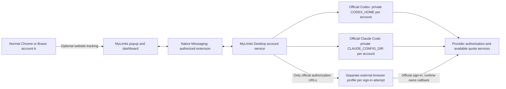

# MyLimits Desktop + extension: independent accounts

Active execution plan, 22 October 2026. Prepared on
`docs/desktop-accounts-execution-plan`, based on `feature/independent-provider-proof`.
**Status: 3.4 code, automated integration and packages delivered on
`feature/desktop-independent-accounts`; real two-account acceptance is still pending
for both providers. The feature is not release-ready.** See
[delivery and exact evidence](DESKTOP-ACCOUNTS-HANDOFF.md).

## 1. Agreed product and honest boundary

Deliver one Windows desktop installation alongside the existing extension.
The desktop component owns separate official provider login profiles; the
extension combines their available quotas. This replaces the installation-free
hosted execution goal. It does not claim that goal was achieved.

Required journey:

1. Install the extension. Website account detection works immediately.
2. For independent accounts, install MyLimits Desktop once through a guided EXE.
3. Provider **+** offers **Use current browser account** and **Connect another account**.
4. Connect another account opens the provider's official authorization URL in a
   separate browser profile, controlled by the desktop connection manager.
5. The user signs into B. The ordinary Chrome/Brave session stays signed into A.
6. Verify B through the official runtime, show its reported identity for confirmation,
   let the user name it, then add it beside other connections.
7. Repeat for A or more accounts. Each has its own login profile, refresh, errors,
   reconnect and disconnect. A website-tracked A is not implicitly an independent A.
8. With provider tabs closed, eligible checks still run while the desktop service
   is available. Account usage elsewhere appears after a successful current
   provider read; neither instantaneous updates nor indefinite authorization is promised.

Users need no Node/npm, recurring terminal commands, pasted tokens, cookies,
manual config editing or manual extension ID in the supported public installation.
Provider authorization, terms, subscription eligibility and Windows installation
prompts remain real steps. An ordinary new tab/window shares the existing login;
its visual size does not create account isolation.

Windows x64 with Chrome and Brave is the first target. Edge is a later compatibility
check. Preserve Firefox website tracking; do not claim a Firefox native installer.
Mac/Linux packaging, hosted monitoring, coaching, proxies, leaderboards and unrelated
provider additions are outside this execution cycle.

## 2. Reuse before adding code

The 3.2 local implementation is present beneath the 3.3 hosted-first interface.
Inspect it before writing another connector or desktop framework.

| Existing files | Reuse | Gap to resolve |
| --- | --- | --- |
| `companion/connections.mjs`, `service.mjs`, `daemon.mjs` | Account ownership, queues, state, generation fencing | Audit capability claims, identity confidence, runtime lifecycle and migrations |
| `companion/app-server.mjs`, `limits.mjs` | Official Codex login/account/quota RPC and normalization | Real A/B identity, scope, renewal and cross-device acceptance |
| `companion/claude-adapter.mjs`, `proof/claude.mjs` | Official auth/status and PTY `/usage` | Current supported CLI compatibility, account selection, upstream freshness |
| `companion/auth-browser.mjs`, `claude-browser-route.mjs`, `windows/claude-browser.cs` | Fresh browser profiles and official CLI browser routing | Authenticated Windows account-B completion and process cleanup |
| `companion/host.mjs`, `local-auth.mjs`, `protocol.mjs`, `src/platform/companion.ts` | Authorized Native Messaging/local IPC | Desktop readiness, version negotiation and reconnection UX |
| `src/core/independent-contract.ts`, `independent.ts`, `connections.ts` | Typed account/readings and source separation | Add only missing lifecycle/identity semantics without breaking stored accounts |
| `src/ui/AccountConnect.tsx`, `OpenAICompanion.tsx`, `Popup.tsx`, `App.tsx` | Compact UI, accounts, aliases, history | Make desktop connection the actual independent path; remove hosted detours from this flow |
| `companion/windows/setup.ps1`, `installer.nsi`, `install.mjs`, `discovery.mjs` | Per-user GUI, registration, runtime selection, uninstall | Guided setup, stable IDs, dependency downloads, honest size reporting |
| `scripts/package-companion.mjs`, `companion-dependencies.mjs`, Windows CI | Pinned binaries, checksums, native tests | Smaller bootstrapper, measured payload, update/rollback/install smoke tests |
| `companion/proof/`, `scripts/account-proof.mjs`, existing tests | Reproduction, redacted evidence, actual PTY mechanics | Promote proven behavior; fixtures do not establish provider capability |

The hosted API, encryption and scheduler remain in the repository for optional
snapshot sync/future work. They are not required for local independent connections.
Do not delete working server or website code while cleaning documentation.

## 3. Architecture and stack



- Extension: existing WXT, React, TypeScript, Zod, browser local storage/history.
- Desktop service: existing pinned Node 24 runtime and JavaScript modules.
- Windows UI: reuse current PowerShell/Windows Forms setup and small C# launcher.
  A standalone tray/control window is optional recovery UI, not a second dashboard.
- Provider processes: unmodified official Codex App Server; unmodified official
  Claude Code with existing `node-pty`/ConPTY and headless terminal parser.
- Transport: Native Messaging plus existing authenticated per-user IPC. No new
  public HTTP endpoint or cloud login is needed for this path.
- State: keep versioned, atomic local metadata/history and current extension
  storage. Introducing SQLite or porting the service to Rust/.NET is unnecessary
  unless a measured defect makes it required.
- Installer: reuse NSIS and the Windows setup infrastructure. Add a thin online
  bootstrapper; download only required, permitted, integrity-verified components.
  Keep an explicitly larger offline option separate if useful.

Do not bundle Electron/Chromium or build a custom OAuth implementation. Reuse an
installed Chrome, Brave or Edge executable with a MyLimits-owned profile directory.
WebView2 is a possible later shell, not a validated provider-login shortcut.

## 4. Provider contracts and decisions

### OpenAI: official local managed route first

Use the official App Server's managed login, account read and rate-limit read
methods in a unique `CODEX_HOME`. Keep callback completion on the user's machine.
Verify the installed protocol/version; let Codex manage credentials and renewal.
Do not read/export `auth.json` or reuse another application's OAuth client.

Label returned buckets with their actual scope and duration. Codex/Work quota
does not establish ordinary ChatGPT chat, image, upload or voice allowances.
Do not send model turns to generate a quota reading.

The inspected managed account interface reports email/plan but not an immutable
subject/workspace ID. Resolve whether a documented official method supplies more
identity. If not, retain `identityConfidence=cli-reported-email` and null immutable
fields; require explicit account confirmation and never deduplicate on email alone.
Two distinct emails can be tested as distinct reported accounts. Same-email
workspaces remain ambiguous until a supported workspace identifier is available.

### Claude: official local route, separately proven

Use a unique `CLAUDE_CONFIG_DIR`, official `auth login --claudeai`, and official
`auth status --json`. Existing BROWSER routing already has unauthenticated binary
evidence; test real completion instead of rediscovering whether the hook exists.
The browser hook launches the allowlisted URL only; official Claude Code owns
the authorization exchange, callback, credential storage and renewal.

Read `/usage` through the existing bounded PTY/parser. Verify CLI-reported
identity/config directory before and after. Preserve actual supported windows,
unknown resets and unknown provider observation time. Avoid hooks, MCP, tools,
project instructions and model prompts during collection. Do not auto-accept
terms or trust prompts; handle required official onboarding explicitly.

Passive status-line snapshots can supplement local history, but are not active
quota polling. Demonstrate that a new `/usage` read reflects usage made elsewhere
while this local account is idle. Without that evidence, expose the route as
experimental and do not claim independent current refresh.

Confirm the proposed monitoring and official-binary installation/distribution
against current provider conditions. Source code in a competitor is not permission.
If a provider restriction or technical failure prevents this route, document the
exact blocker immediately; keep other independent work moving. No cookie import,
custom OAuth, CLI-token extraction, unofficial client impersonation or login-switch
fallback is authorized by this plan.

### Common connection record

Preserve existing IDs, aliases and history. Each record needs:

- Immutable local `connectionId`, provider, connection kind, profile reference,
  auth generation and independent refresh capability.
- Separate editable alias, transient display identity, identity confidence and
  provider subject/workspace identifiers only when officially available.
- Authentication state, last attempt, last successful fetch, provider observation
  time when supplied, error/stale state and next permitted refresh.
- Actual quota scope/window, units, reported values and provider reset times.

Website sessions, independent profiles and historical readings are separate
sources. Never silently merge them, change an account because its alias matches,
or count several readings of the same allowance as additional available quota.
Use `possibleDuplicate` when evidence is incomplete; no email-only automatic merge.

## 5. Sequential implementation checklist

All software tasks below start pending. This document and the documentation
cleanup do not complete an implementation task. Use a new
`feature/desktop-independent-accounts` branch from this documentation branch.
Work one task at a time; no parallel agents. Update the status ledger after each.

### D01 — Audit and reproduce the existing local path

- Inventory the files above, current contracts, failing/stubbed paths and package
  contents. Distinguish the 3.3 hosted default from the advanced 3.2 local route.
- Run focused connection/account-proof tests and inspect Windows CI evidence.
- Produce an exact reuse/gap list and dependency/version/size baseline.
- **Done:** executable local reproduction and a gap list; no unsupported capability
  is inferred from the existing `available`/`isolatedLogin` flags.

### D02 — OpenAI account-isolation proof before UI expansion

- Reuse managed App Server sign-in and isolated external browser routing.
- Connect A and B in two profiles, compare official account metadata and quotas,
  confirm ordinary Chrome/Brave remains A and display B before committing it.
- Test duplicate/wrong-account selection, cancellation, late callbacks, provider
  tabs closed and refresh after remote-device use.
- If accounts are unavailable, finish an executable user-run GUI path under an
  experimental flag and record exact pending tests. Do not substitute fixture proof.
- **Done:** supported code path and real evidence recorded; without live access,
  implementation may proceed but this provider gate remains UNVERIFIED.

### D03 — Claude account-isolation and freshness proof

- Reuse the official login/browser router and profile-aware auth/status checks.
- Verify real B login through the separate profile, official onboarding, callback
  completion and normal browser A remaining unchanged on Windows.
- Compare fresh `/usage` results to the provider display for both accounts; use
  another device and check again without sending a local model prompt.
- Record terms/distribution decision and required supported CLI versions.
- **Done:** separate real identity and active current quota evidence. Otherwise
  record BLOCKED/UNVERIFIED and keep experimental capability honest.

### D04 — Account records, identity and migration

- Make only necessary additive schema changes; use typed validation at each boundary.
- Preserve `openai-companion:<uuid>` and `claude-companion:<uuid>`, profile paths,
  aliases, ordering, per-account preferences and historical timestamps.
- Back up metadata before migration, validate before atomic replacement and make
  retries idempotent. Never migrate/copy provider credential contents.
- Keep same-email workspace ambiguity and wrong-account reconnect visible.
- **Done:** migration/restart/duplicate fixtures pass with unchanged old data.

### D05 — Refresh and process ownership

- Serialize login/read/reconnect/logout per account; bound total provider processes.
- Retain conservative existing cooldowns initially (OpenAI 2 minutes, Claude 5
  minutes), increase when provider hints require it, and persist Retry-After/backoff.
  These intervals are prototype policy, not provider-approved refresh guarantees.
- Coalesce clicks and native clients; startup/browser reopening refreshes only
  eligible accounts. A failed read preserves last success and its timestamp.
- Default polling may pause when no extension client is attached. Closing provider
  tabs must not stop independent checks; closing the whole browser may pause them.
  This product does not require an always-on remote monitor.
- Close only owned child processes, confirm Windows shutdown, retain recovery
  state if writers may still run, and do not delete active browser profile folders.
- Website logout and global provider revocation must be treated separately.
- **Done:** expiry/offline/throttle/cancel/restart tests pass without refresh storms.

### D06 — Desktop readiness and Native Messaging

- Keep one service/lock for all browser clients; use the existing authorized host,
  framing limits, version negotiation and authenticated IPC.
- Support capabilities/list/start/cancel/confirm/rename/refresh/reconnect/disconnect.
  Add commands only if missing; no arbitrary executable, path or URL from a page.
- Recover from native port loss and desktop restart; preserve pending attempts when
  popup closes. Persist safe attempt IDs/status, never raw authorization URLs/state.
- For public builds authorize actual stable Chrome/Brave extension IDs. Build-time
  development IDs stay clearly separate. Store publication itself is not this task.
- **Done:** real extension-to-local-service fixture transport and negative tests pass.

### D07 — Connect through + in the extension

- Make local desktop connections the default independent option for this build;
  the empty hosted driver map must not intercept or falsely complete the journey.
- Desktop absent → concise one-time install screen; desktop ready → provider's
  actual official sign-in → reported identity confirmation → alias → connected.
- No success on window opening, route marker, CLI exit alone or fictional data.
- Handle wrong account, possible duplicate, quota unavailable after successful
  login, cancellation, timeout, expired session and incompatible desktop version.
- Keep compact provider-logo/alias rows, actual quota bars/reset times, last success,
  stale/reconnect, refresh, + and Full dashboard. Put setup/history/details there.
- Preserve website auto-detection; no provider toggles or Guide restoration.
- **Done:** browser flow tests pass and actual provider route is reachable on Windows.

### D08 — One guided Windows setup and smaller initial download

- Audit current ~200 MB complaint with measured bootstrapper, total downloaded,
  installed and cached bytes. Compression and download staging are different.
- Build one per-user EXE that detects the extension/browser, installs the native
  host, verifies readiness and returns users to the extension. No ZIP-within-ZIP
  or terminal instructions in the end-user flow.
- Reuse safe compatible installed components or download the required pinned
  runtime from official permitted sources. Install only selected providers; use
  official Claude installation rather than redistributing it without permission.
- Show progress, total downloads, errors/retry and required provider/system prompts.
  Verify integrity and executable layout before activation; reject corrupt archives.
- Keep Node/provider runtime isolated from the user's global installs. Do not bundle
  Chromium, source checkout, dev dependencies or all-platform binaries.
- **Done:** clean Windows install connects from the extension, and actual size/time
  measurements are recorded. No invented MB target or literal one-click claim.

### D09 — Upgrade, uninstall and delivery packaging

- Atomically stage compatible updates, preserve official profile ownership and
  offer rollback of executable files without rewriting credentials or history.
- Disconnect B requests only B's official logout; delete only owned data after
  confirmed process exit. Uninstall offers keep/delete local account data and
  removes only owned tasks/registrations. Local deletion is not remote revocation.
- Build extension ZIP, desktop setup EXE, checksums and dependency/license manifest.
  Exercise installer/update/uninstall from a clean Windows user.
- Public signing/store approvals are explicit external release prerequisites;
  unsigned development artifacts stay labelled. Do not publish a release here.
- **Done:** artifacts and installation/recovery steps correspond to the same source.

### D10 — Acceptance and handoff

- Run appropriate focused and full regressions after implementation. Keep simulated
  tests separate from official-binary observations and authenticated account tests.
- Complete the live matrix below per provider, including both Chrome and Brave.
- Write `docs/DESKTOP-ACCOUNTS-HANDOFF.md` only when handing off implemented work:
  changed files, exact checks, artifact sizes/checksums, install/test steps, remaining
  blockers and real scope. Update existing docs rather than adding competing plans.
- Commit coherent checkpoints and push the feature branch. No main merge/release.
- **Done:** both provider gates pass. If one does not, report partial/incomplete
  delivery; code completion and live acceptance remain separate status columns.

## 6. Required verification

Automate meaningful coverage for A/B profile/identity isolation, same-email ambiguity,
wrong account, cancellation and late callbacks, migration/history preservation,
reconnect generations, token expiry as reported by official runtimes, throttling,
offline failures, stale timestamp retention, native input/origin validation,
credential-free logs/messages, independent disconnect and Windows owned shutdown.
Install/bridge tests must exercise actual subprocess/native transport, not only
mock React components. Do not capture real authorization material in fixtures.

Suggested existing commands (record actual counts, failures and skips):

```sh
npm run test:account-proof
npm run test:connections
npm run typecheck
npm test
npm run test:companion
npm run test:browser
npm run build
npm run zip
node scripts/check-packages.mjs
```

For archive checks use `python3 scripts/check-archives.py` with the arguments
documented by that script. Windows CI also runs native
ConPTY/router/setup/installer checks; inspect the workflow for current commands.
Add the bootstrapper smoke suite as part of D08/D09 instead of pretending it exists.

| Live acceptance — never tick from fixtures | OpenAI/Codex | Claude |
| --- | --- | --- |
| Two actual eligible accounts signed in separately | PENDING | PENDING |
| B confirmed; ordinary browser remains A | PENDING | PENDING |
| Both identities/scope compared with official display | PENDING | PENDING |
| Both accounts independently return current quotas | PENDING | PENDING |
| Other-device activity reflected on next eligible check | PENDING | PENDING |
| Provider tabs closed; refresh succeeds | PENDING | PENDING |
| Browser/desktop restart preserves accounts and refresh | PENDING | PENDING |
| Ordinary website logout behavior recorded | PENDING | PENDING |
| Global revocation and reconnect recorded | PENDING | PENDING |
| Actual credential renewal observed | PENDING | PENDING |
| Disconnect B leaves A working | PENDING | PENDING |
| Clean Windows Chrome and Brave install/update/uninstall | PENDING | PENDING |

## 7. Evidence, inspiration and working rules

Use [competitor research](COMPETITOR-RESEARCH.md), especially its 22 October update,
and [historical evidence](IMPLEMENTATION-HISTORY.md). ClaudeBar's official-profile
approach is the primary reference. AIUsage's account UI and UsageAtlas's analytics
are inspiration; their different credential/snapshot methods are not silently adopted.
Do not repeat broad research or copy entire projects. Check licenses and attribute
any actually reused source; closed-source products inform behavior/design only.

Verify unresolved interfaces against [Codex App Server](https://developers.openai.com/codex/app-server/),
[Claude authentication](https://code.claude.com/docs/en/authentication),
[Claude CLI](https://code.claude.com/docs/en/cli-reference) and
[Claude credential conditions](https://code.claude.com/docs/en/legal-and-compliance).

Preserve user changes; work sequentially. Keep project Markdown directly in docs/.
Update IMPLEMENTATION-STATUS after every task with files, commands/results, evidence
level, decisions, blockers and exact next action. Accounts unavailable means live
checks stay pending; a missing executable route means code is incomplete. Continue
work independent of blocked provider access, without claiming the blocker solved.
Final report: IMPLEMENTED / AUTOMATED TESTED / LIVE VERIFIED / BLOCKED OR UNVERIFIED.
