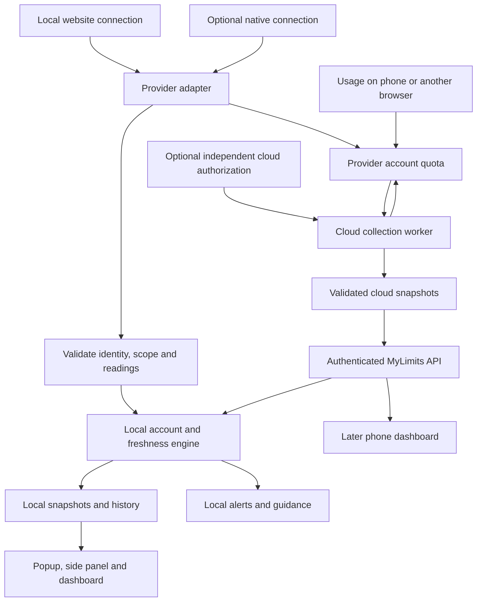

# MyLimits 2.0 implementation plan

Date: **15 October 2026**. Status: **detailed execution specification for GPT-6.1 Sol; application and cloud changes have not started**.

Inputs: the agreed product redesign, [competitor research](COMPETITOR-RESEARCH.md), [current architecture](ARCHITECTURE.md), [roadmap](ROADMAP.md) and [OpenAI companion](OPENAI-COMPANION.md). This plan adds a conditional backend path following the request to investigate tracking after website logout. It does not assume a cloud provider, paid service, deployment or credential upload has been selected.

Execution order: [START-HERE](START-HERE.md) → this master specification →
[Phase 1](PHASE-1.md) → [Phase 2](PHASE-2.md). Update
[IMPLEMENTATION-STATUS](IMPLEMENTATION-STATUS.md) after each work package. The
[starter prompt](STARTER-PROMPT.md) starts implementation of Phase 1 only.

There are exactly **two implementation phases, each budgeted at 100 relative
effort points**. Points estimate engineering work, not elapsed hours or guaranteed
provider access. Task IDs, dependencies, expected files and verification cases
are supplied so another model can implement without reconstructing chat history.

## 1. Product outcome

Install MyLimits, enable a provider, and see the useful limits with minimal setup. Keep several named accounts organized, warn before an applicable allowance runs out, and help users choose an appropriate account/model for their next task.

The core product works without a MyLimits account or mandatory companion. Independent connections, including hosted collection where supported, are an additional connection option. Closing the browser does not need to stop a cloud collector, but always-on collection is optional rather than a requirement for basic tracking.

Primary acceptance targets are Windows desktop Chrome and Brave. Edge and Firefox follow explicit compatibility checks. A phone web dashboard is a later cloud feature; desktop extension support does not imply Chrome mobile extension support.

## 2. Architecture decision: why a backend is optional

The extension can already run scheduled background requests, use an existing permitted website session, validate quota responses and store readings locally. Those operations do not intrinsically require a server.

A backend becomes useful for a different requirement: maintaining a separate authorized connection, collecting independently of one browser session, aggregating several accounts and supplying the same readings to multiple devices. **A backend supplies a place to run a collector; it does not supply provider authorization or missing quota endpoints.**

### Connection options

| Mode | Authorization and execution | Behavior after website logout | Initial scope |
| --- | --- | --- | --- |
| Website connection | Extension uses the current browser login | May stop when that session is invalidated | Default core product |
| Independent local connection | Separate provider-supported grant; extension or optional native collector | Can continue only while that grant remains accepted | Provider-specific validation |
| Cloud snapshot sync | Extension uploads permitted readings/settings, not provider credentials | Other devices can view dated snapshots; collection still needs a functioning source | Optional later feature |
| Independent cloud connection | Backend maintains a separately authorized provider connection | Can continue after an unrelated browser-session logout if the provider permits it | Conditional cloud pilot |
| Hosted browser session | Isolated remote browser has its own provider login | Depends on remote-session validity and provider session policy | Research option, not the default implementation |

### What “keep them logged in on a server” can mean

The preferred approach is a provider-supported OAuth or equivalent authorization flow with access to the required quota resource. A user authorizes the MyLimits connection on the provider's site; the collector receives the permitted credentials and renews them when allowed. The MyLimits sign-in and provider authorization remain separate concepts.

A remote browser can technically retain its own login and read a website's usage view. However, it requires a user-authorized remote sign-in, isolated browser state and recovery when authentication expires or verification is requested. Not every provider supports or permits that deployment. Remote browsers have higher operating and maintenance costs than lightweight API collectors. They are a feasibility experiment, not a universal fallback.

Copying the current Chrome cookie/token to the server does not create an independent grant. If that session is invalidated, keeping another copy cannot restore access. A refresh token also remains subject to revocation; it is not a permanent login. [OAuth revocation semantics](https://www.rfc-editor.org/rfc/rfc7009.html)

OpenAI's session management documentation distinguishes ending one session from logging out all active sessions. This supports the general idea of separate sessions, but does not by itself prove that a particular MyLimits credential survives a particular logout action. [OpenAI active sessions](https://help.openai.com/en/articles/20001257-managing-active-sessions-in-chatgpt)

### OpenAI-specific feasibility boundary

Current Sign in with ChatGPT documentation distinguishes identity from permission to use a ChatGPT plan for eligible inference requests. Neither should be assumed to provide arbitrary account quota access. The open-source plan-usage documentation directs paid or remotely hosted offerings to an interest process; a local integration is not automatically a hosted-service entitlement. [Quickstart](https://developers.openai.com/siwc/quickstart), [local/open-source overview](https://developers.openai.com/siwc/token-sharing-open-source)

The existing companion uses Codex App Server to read the returned quota buckets. We must test which authorization types support that operation in the intended deployment. Ordinary ChatGPT chat/model limits remain a separate capability. Do not send an inference request simply to discover quota data. [Official App Server documentation](https://developers.openai.com/codex/app-server/)

**Architecture recommendation:** preserve a useful extension-only path and add an optional cloud connector service only for providers whose authorization, quota scope, renewal and deployment support pass the feasibility gate. Universal logout-independent tracking is not a release promise.

## 3. First milestone: prove the connection behavior

Before building a production cloud service, create a capability record for each provider and connection method. Use sanitized response fixtures and account-owner-authorized live checks. Do not put credentials or authenticated browser state in fixtures, logs or the repository.

Record these cases separately:

1. Provider tab open and closed, with the browser running.
2. Browser restart without opening the provider site.
3. Usage on another device or browser that shares the relevant quota pool.
4. Ordinary logout from the original website session.
5. Explicit logout/revocation of the collector's own connection.
6. Global logout, where the provider offers it; record the actual effect without assuming every OAuth grant behaves like a website session.
7. Access-token expiry, supported renewal and refresh-token rejection.
8. Multiple provider accounts and account/workspace switching.
9. Provider/network failure, throttling and recovery.

Each capability is `verified`, `unsupported` or `unverified`, with test date, deployment type, response scope and relevant plan/workspace. A credential being accepted for inference or identity is not evidence that it can read quotas.

The cloud gate passes only when at least one provider has a permitted independently authorized connection, a usable quota source, correct account identity, predictable renewal and clear revocation behavior in the proposed hosted environment. If it fails, document the reason and continue the local redesign without advertising that cloud capability.

## 4. Feature scope and release priorities

| Capability | Phase 1 | Phase 2 / conditional |
| --- | --- | --- |
| Connection | Provider selection, optional site access, reuse existing login | Independent authorization and hosted collection per verified provider |
| Accounts | Nicknames, reorder/pin, account/workspace identity, reconnect/remove | Multiple independently updating accounts where authorization permits |
| Overview | Compact session/weekly meters and reset times | Optional custom meter selections and page widgets |
| Status | Updating, remembered, sign-in required, unavailable, local activity only | Source diagnostics and cloud connection health |
| Refresh | Startup, manual and scheduled collection with backoff | Provider-supported faster updates or event-driven collection |
| Alerts | Low/critical balance, confirmed resets, deduplication, snooze, quiet hours and mute | Cross-source/cloud delivery coordination where enabled |
| History | Local normalized readings, gaps, basic history view and safe export | Rich charts, pacing ranges, reset timeline and extended retention |
| Guidance | Tracking remains focused; no placeholder Guide screen | Maintained local task/model guide, user-supplied prompt utilities and deliberate handoff |
| Sync | Local-only default | Snapshot sync, account/settings sync and phone dashboard |
| Native tools | Existing companion remains optional | Packaged installers and additional native-only sources |

“Supported provider” means specific verified meters, not every limit that the provider might enforce. API spend, credits, coding-plan allowances, consumer chat limits and browser activity counts remain distinct.

## 5. Interface redesign

### Popup

Target roughly six named account rows at normal desktop scaling, with session/weekly values, reset information, status and a manual refresh control. Keep connection instructions out of the ordinary overview. Click a row for additional windows, model-specific limits and connection details.

```text
MyLimits                              Updated 1m ago  ↻
Account                  Session left         Week left
Claude Work                  35%                  62%
Claude Personal              80%                  25%
Codex Main                   55%                  41%
Codex Other                  Needs sign-in
Gemini                       Quota unavailable

2 accounts low                    Next reset: 42m
+ Add account                          Open dashboard
```

Numbers are fictional. Arbitrarily many accounts/windows cannot fit in a fixed popup; use pins, search and the dashboard beyond the common case. Preserve intrinsic popup width and test Windows display scaling to prevent the narrow-strip regression.

### Other surfaces

- **Side panel:** persistent compact monitoring with the same underlying readings.
- **Dashboard:** Overview, Accounts, History, Guide and Settings; full account/source details and diagnostics.
- **Optional page widget:** small movable/collapsible usage strip on enabled sites; never required for background collection.
- **Later phone dashboard:** read the user's cloud-authorized snapshots and distinguish independently collected readings from uploaded cached ones.

Use shared components, design tokens, light/dark themes, keyboard navigation, accessible names and text/status icons alongside color. An unavailable quota must not look like zero or a full allowance.

## 6. Domain model and original MyLimits logic

Separate entities that are partly combined in the current prototype:

| Entity | Responsibilities |
| --- | --- |
| Provider definition | Fixed origins, supported meter scopes, connector version and declared capabilities |
| Provider account | Verified provider account ID, user nickname and optional plan metadata |
| Workspace | Explicit workspace/organization identity and selection |
| Connection | Local website, independent local, companion, cloud or imported snapshot; lifecycle and credential reference |
| Quota meter | Stable ID, applicability, unit, reported values and reset metadata |
| Snapshot | Connection/account/workspace, source, observation time and normalized meter readings |
| Preferences | Pins, order, display mode, notifications and guidance preferences |

Own implementation rules:

- Key data by verified account/workspace and connection; never merge users because names, emails shown in the UI or percentages happen to match.
- Keep multiple source readings distinct unless a verified mapping establishes they describe the same account, quota scope and window. Never combine separate meters into an invented total percentage.
- Keep `observedAt`, `receivedAt` and `lastAttemptAt` separate. Uploading an old reading must not make it fresh.
- Treat `unknown`, `unavailable`, local observed activity and estimated work remaining as different evidence types.
- Determine account headroom from applicable quota windows, not an average. A recommendation must consider task/model applicability.
- Preserve the last successful reading when requests fail, but exclude stale/unknown data from factual low-quota alerts and capacity recommendations.
- At a reset timestamp, mark the previous window as needing refresh; do not invent a new full allowance.
- Keep preview data out of connected-account storage and all real provider requests.

One browser profile normally supplies one current website login per provider. Remembered account nicknames are independent of having live credentials for every remembered account. Cloud infrastructure does not remove that distinction.

## 7. Collection architecture



The provider is authoritative for account-wide quotas. Collecting metadata from one device cannot reveal usage elsewhere unless that source reports the shared pool. A live connection between our server and UI cannot make a slowly polled upstream quota real time.

### Extension scheduler

Start with a five-minute default where allowed, plus startup and coalesced user-triggered refresh. Use persisted scheduling metadata suitable for Manifest V3 service-worker restarts. One in-flight operation per connection, bounded provider concurrency, request timeouts and generation checks prevent stale results from reactivating disconnected accounts.

Respect provider retry instructions and exponential backoff. Renewal failures pause that connection and display a clear reconnect action. Scheduled collection must not create surprise login windows. Do not make hidden model requests, spend credits or consume reset credits.

### Proposed optional backend

Use a small TypeScript service and worker, rather than microservices:

- **API:** Fastify with Zod contracts, authenticated account/snapshot endpoints and a connection-management API.
- **Storage:** PostgreSQL for users, provider-account mappings, connections, snapshots, preferences and job metadata.
- **Queue:** initially a PostgreSQL-backed durable job queue with leases/locks and one renewal operation per connection. Add a separate queue service only when measured load requires it.
- **Authorization:** managed MyLimits authentication; separate provider OAuth clients/callbacks where supported. Use state/PKCE, validated redirects and server-side token exchange as appropriate for the provider.
- **Secrets:** a managed secret/KMS service with encrypted credential envelopes and tenant-bound access. Only collectors that need a credential can decrypt it; no credentials in dashboard responses, extension exports, snapshots or logs.
- **Delivery:** authenticated snapshot fetch first; optional SSE for active web dashboards. An extension can fetch on alarms/open rather than depend on a permanently running worker connection.
- **Operations:** health checks, collection success/age metrics, bounded retries, per-provider budgets and a reconnect queue. Avoid storing response bodies that contain personal or authentication data in diagnostics.

The worker must be able to use its authorized credentials, so this credential-holding cloud mode is **not zero-knowledge**. Snapshot-only sync can avoid uploading provider credentials and remains a separate choice. Local-only users should not need MyLimits authentication.

Cloud routes must enforce account ownership on every read, update and connection action. Bind provider callbacks to the authenticated initiating user; linking a provider login to another MyLimits user is not an automatic merge. Revocation/disconnect must cancel queued/in-flight writes, stop collection and delete retained credentials, with provider revocation where supported.

Select hosting, auth and KMS vendors after the cloud feasibility gate. No production deployment or paid resources are part of this document-only task.

### Hosted browser feasibility option

If a provider offers no suitable API connection, evaluate an explicitly user-authorized isolated remote session only after reviewing its supported usage. Record sign-in/MFA flow, available usage data, expiry/reverification, resource use and cross-user isolation. Do not collect passwords for automatic replay or bypass verification controls.

Store remote authenticated state with the same protection as provider credentials. Playwright documents that persisted browser state can grant account access; a saved profile is not merely a harmless quota cache. [Authentication state documentation](https://playwright.dev/docs/auth)

Do not keep a full browser process permanently open if a permitted lightweight API collector suffices. A browser-based pilot should be abandoned if it requires frequent verification or cannot offer a dependable consumer experience.

## 8. Provider sequence and acceptance

| Priority | Provider | Work |
| --- | --- | --- |
| 1 | Claude | Validate website account/workspace and reported windows; investigate independent grant/hosted support separately |
| 1 | OpenAI/Codex | Validate website reader and separate App Server connection; investigate deployment permission and exact quota scopes |
| 2 | Grok, Perplexity, Gemini | Study quota adapters from the research, implement independently and validate real response semantics |
| 3 | Cursor, Copilot, selected coding plans | Add scoped request/credit/billing meters without conflating them with consumer chat limits |
| 4 | API services/custom integrations | Explicit optional key scopes, budget semantics and maintained connector definitions |

Each release candidate needs a fixed-origin transport, pure parser, sanitized fixtures, capability record and real-account acceptance results. A failing provider must not break collection for others. Ship executable connector changes inside extension/backend releases rather than downloading executable code into the extension.

The earliest reliable release can contain fewer providers than the current catalog. Existing local observations remain clearly labeled until replaced by verified quota sources; they are not converted into server-reported quotas during migration.

## 9. Alerts, history and guidance

### Alerts

Per-account warning and critical thresholds, notification permission after a user action, mute, snooze and quiet hours. Deduplicate on account/scope/meter/reset window; handle missing reset IDs with bounded recovery rules. A later critical crossing can alert after an earlier warning.

Confirmed-reset notifications require a fresh provider reading. If expected-reset reminders are offered, identify them as reminders rather than confirmation. For cloud-enabled users, assign a delivery policy to prevent the same event from notifying through multiple local/cloud sources.

### History and pacing

Store normalized samples in IndexedDB locally and, if opted in, tenant-scoped cloud rows. Set bounded retention/downsampling and preserve gaps, resets and source changes. Support graphs, a reset timeline and CSV/JSON exports with no credentials.

Forecast remaining time/work only from sufficient relevant data, display uncertainty and suppress predictions when stale. API spend, estimated token cost and subscription fees remain separate; do not derive dollars from quota percentages.

### Guidance

Begin with maintained local rules for task type, speed/accuracy preferences, model capabilities and available applicable quota. Explain why an option is suggested. Then add user-supplied prompt review, context/attachment tips, templates and concise-output preferences.

Conversation reading, recap generation and handoff are explicit user-triggered features with previews of what is transferred and whether an AI request is made. They are separate from passive quota monitoring. No hidden routing, prompting or claimed fixed token savings.

## 10. Technical stack and repository boundaries

| Area | Implementation direction |
| --- | --- |
| Extension | Existing WXT, React, TypeScript and Manifest V3 |
| Interface | Shared design tokens/components; CSS and current styling tooling |
| Validation | Zod at transport, message, storage and optional API boundaries |
| Domain logic | Pure TypeScript modules for identity, reconciliation, scope, freshness and alerts |
| Local persistence | Browser local storage for settings/accounts; IndexedDB for history |
| Optional cloud | TypeScript/Fastify, PostgreSQL/durable jobs, managed auth and KMS |
| Optional native | Preserve current companion while validating; package installers later |
| Verification | Focused domain/parser tests and Playwright browser checks; real signed-in acceptance separately |
| Distribution | Reproducible release ZIPs and install instructions, followed by browser-store distribution |

Keep current `src/core`, `src/providers`, `src/platform`, `src/ui` and `entrypoints` boundaries. Introduce connection-specific adapter contracts and migrations before expanding the UI. Put an eventual backend in a separate server package and extract browser-independent schemas into a shared package when two consumers exist. Do not add a monorepo framework solely for the plan.

Proposed future implementation areas: `src/core/connections`, `src/core/migrations`, provider-specific adapter modules, shared UI components, and an optional `server/` service. These paths describe intended work, not existing completed features.

## 11. Two equal-effort implementation phases

| Phase | Work | Relative effort | Deliverable |
| --- | --- | --- | --- |
| **1: Reliable local redesign** | Baseline/capabilities, domain contracts, migration, local adapters, account/connection flows, scheduling, compact surfaces, alerts, local history, release handoff | **100 points; 10 work packages** | A usable, installable redesigned extension with honest provider/source status and preserved user data |
| **2: Expansion and connected services** | Hosted feasibility, tenant API, gated collectors, snapshot sync/phone view, more providers, insights, local guide, page widget, platform/native packaging, final hardening | **100 points; 10 work packages** | A broader product with optional cloud features and explicit provider-dependent limitations |

Phase 1 investigates authorization constraints early without building a cloud
service. Phase 2 runs the actual hosted proof before enabling independent cloud
collection. Snapshot synchronization can remain useful even if that collector
gate fails, but must never be advertised as logout-independent collection.

The 100/100 split balances the planned work, not task counts alone. If a provider
gate materially changes the scope, record the blocked capability and revised
remaining estimates in the status file. Do not invent support, add filler work,
or claim equal elapsed time to preserve the estimate.

Complete Phase 1's handoff before beginning Phase 2. Both can have separately
recorded manual/provider-access checks; a fixture-tested implementation is not a
verified live provider connection. Continue independent work when an external
check is unavailable, and leave the affected capability explicitly unverified.

Implementation should use a dedicated branch. Preserve the current working version, back up storage before migration and avoid discarding unrelated workspace changes. Define rollback across both storage schema and extension versions; do not assume an old extension can interpret a new schema.

## 12. Verification and operating limits

Meaningful checks must cover identity separation, account/workspace switching, out-of-order results, disconnect races, freshness, reset rollover, alert deduplication, migration and provider format changes. Browser tests cover popup dimensions, accessible controls, missing native APIs, optional permissions and visible errors. Run actual Windows Chrome/Brave acceptance for native/OS behavior; Linux fixture tests do not certify Windows.

Cloud checks additionally cover tenant isolation, callback binding, credential rotation races, job retries/leases, revoked access, cancellation, deletion and old snapshots arriving after reconnect. Tests and CI use fictional accounts/fixtures; real credentials remain outside the repository.

For periodic collection, requests/day are approximately `active_connections * 1440 / interval_minutes`, before retries. At five minutes this is 288 requests per connection/day; a provider refresh may require several requests. Apply provider budgets, inactivity policies and bounded retention before scaling. Hosted browsers add memory/CPU and verification-support costs beyond simple API polling. No hosting price estimate is selected without a measured pilot and current vendor pricing.

Release claims must name the provider, meter scope, connection type and supported behavior. “Automatic updates” means the next successful permitted refresh, not a guaranteed instantaneous upstream event. If a provider revokes authorization or withholds a quota resource, show reconnect/unavailable rather than guessing.

## 13. Originality and delivery boundary

Recreate useful commercial product behavior with MyLimits' own code and interface. Study licensed open-source implementations and reuse focused components only after checking their actual grants and preserving attribution. Keep source/license notes for anything incorporated. Do not copy proprietary code, assets or text.

This document records the intended upgrade and the newly considered cloud option. It does not deploy a backend, request provider partnership access, store a user's login remotely or start application implementation.

## 14. Shared implementation contracts

These are proposed contracts. Finalize them in P1-02 against the existing code,
record any justified adjustment, and keep the same semantics throughout both
phases. Avoid implementing a second competing model in UI or server code.

### Identity and connections

- Preserve existing account IDs and installation salt through migration; old IDs
  may already combine account and workspace. Preserve that mapping until verified
  evidence supports a more granular mapping. Do not reverse hashes or guess raw IDs.
- A user-facing account can have several sources, but browser sessions, native
  profiles and cloud grants remain independently addressable connections.
- A workspace is explicit when verified. `null` means no known workspace, not
  permission to combine workspaces.
- Suggested connection kinds: `website`, `companion`, `independent-local`,
  `cloud`, `snapshot-import`. Only implement usable kinds in each phase; listing
  a kind in a type does not enable that connection method.
- Suggested lifecycle: `disabled`, `checking`, `active`, `needs-auth`,
  `needs-tab`, `unavailable`, `offline`, `error`. Derive the display-only
  “remembered” account label from its connections and dated readings.
- One website-session connection may change the detected current account when
  the user signs into another login. Detach its live mapping from the previous
  account while retaining that account's nickname and snapshot. Native/cloud
  connections for other accounts must remain active.
- Increment a connection generation on disable, disconnect, account rebinding
  or credential replacement. A response from an older generation cannot mutate
  current state. Account deletion additionally removes history and preferences.

### Snapshot contract

Use runtime-validated data with the following fields or their documented equivalent:

```ts
type Evidence = 'reported' | 'observed' | 'estimated';
interface UsageSnapshot {
  schemaVersion: 2;
  snapshotId: string;
  providerId: string;
  accountId: string;
  connectionId: string;
  workspaceId: string | null;
  observedAt: number; // milliseconds UTC; age of the actual reading
  receivedAt: number; // milliseconds UTC; local ingestion time
  connectorVersion: string;
  meters: UsageMeter[];
}
interface UsageMeter {
  id: string;
  label: string;
  scope: 'subscription' | 'work-codex' | 'chat' | 'api' | 'local';
  evidence: Evidence;
  unit: 'percent' | 'messages' | 'requests' | 'searches' | 'credits' | 'currency';
  used: number | null;
  total: number | null;
  usedPercent: number | null;
  currency: string | null;
  resetsAt: number | null;
  windowId: string | null;
  sourceLabel: string;
}
```

Reject non-finite values, negative counters and malformed timestamps. Percentage
clamping for visual display must not hide malformed input. A positive total is
needed for division; reported zero is valid and unknown is `null`. Monetary
values require a currency and cannot silently mix currencies. Retain separate
windows even if their reset times coincide. Validate clock skew/old arrivals
before selecting the current snapshot; a newer arrival can contain older data.

Transport-level transient identity/authentication is not part of the public
snapshot. Account verification happens before publishing the normalized record.
The UI never receives raw responses, salts, cookie values, access/refresh tokens
or native bridge secrets.

### Adapter and capability contract

An adapter takes a permitted connection context and abort signal, returns a
normalized validated snapshot or typed error, and declares fixed provider
origins. Inject transport and clocks for tests. Errors distinguish authentication,
missing page context, permission denial, network/offline, throttling with retry
time, unsupported quota scope and unexpected response shape.

Capabilities record tab-independent access, account-wide scope, supported meters,
multi-account behavior, independent authorization, renewal and hosted deployment.
Each includes `supported`, `unsupported` or `unverified`, its evidence level
(`documentation`, `fixture`, `live`), last check date and connection type.
Do not promote documentation/fixture evidence into live support automatically.

### Storage and messages

- Existing state key: `mylimits:state:v1`. Introduce an explicitly versioned V2
  key only after schema validation and backup; preserve V1 for recovery. A pointer
  to the active schema is written only after the V2 state is durable and validated.
- Existing IndexedDB: `mylimits-history`, version 1, store `readings`, indexes
  `account` and `time`. Browser storage and IndexedDB do not share an atomic
  transaction: use a resumable migration journal and make retries idempotent.
- Default history retention remains 30 days until Phase 2 changes it explicitly.
  Keep legacy history usable with a documented legacy-source mapping.
- Serialize writes; reject unrecognized versions without resetting data. Never
  “fix” parse failure by silently creating an empty store over the saved record.
- Extend validated messages for connect/enable, account preferences, workspace
  selection, refresh by connection, disconnect, forget and paginated history.
  Public state uses purpose-built public types; private fields are not excluded
  merely by relying on callers to ignore them.
- Keep the current observation sender/origin/path checks. Page messages cannot
  choose arbitrary fetch origins, invoke cloud actions or issue UI commands.

### Alert and timing contract

Use one unit throughout storage and messages: epoch milliseconds. Convert source
seconds/durations in parsers only. Clock injection makes reset/freshness tests
deterministic. Schedule collection with browser alarms, not a permanent worker
loop. Refresh-on-open reuses an already fresh/in-flight read rather than causing
a network storm. The quiet-hours policy uses local time with a defined overnight
range; it suppresses delivery, not quota collection.

Alert identities include account, workspace/scope, meter and reset window.
Do not collapse different quota windows into one ledger entry. Snooze/quiet
hours must not falsely mark an undelivered alert as delivered. When notifications
resume, alert once only if a fresh currently low reading still warrants it.

## 15. Scope control for the executing model

Use the task files as ordered executable specifications, not invitations to
redesign the architecture again. Implement one work package at a time and update
the status file with changed files, actual commands/results, decisions and next
action. Read the relevant task and contracts rather than reloading all research
on every step. No parallel agents are part of this handoff.

Keep existing WXT/React/TypeScript/Zod tooling and Node 24+ unless a concrete
failure requires a narrowly justified change. The unit runner imports test
modules explicitly; new `.test.ts` files must be wired into it. Do not replace
the test framework, introduce a monorepo framework, add a UI state framework, or
upgrade dependencies simply because the plan is a redesign.

Read the existing implementation before editing, particularly companion handling
and account reconciliation. Preserve regression tests. Run focused tests during
each package, then the required integration/build checks at the phase gate;
record blocked checks honestly instead of claiming a pass or repeatedly rerunning
successful unchanged checks. Changes to shared semantics require updating the
master contract and downstream task notes in the same work package.
